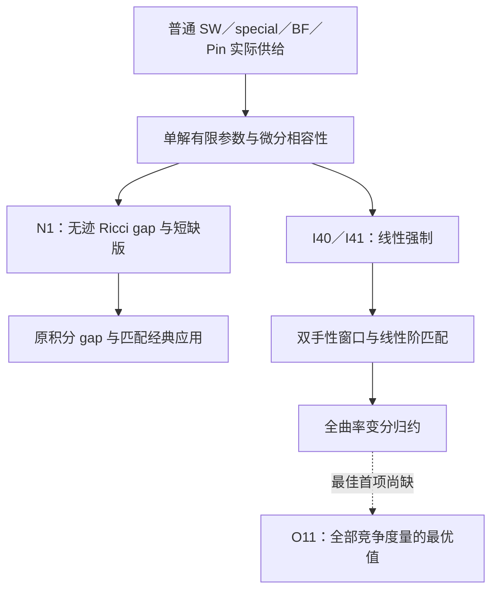
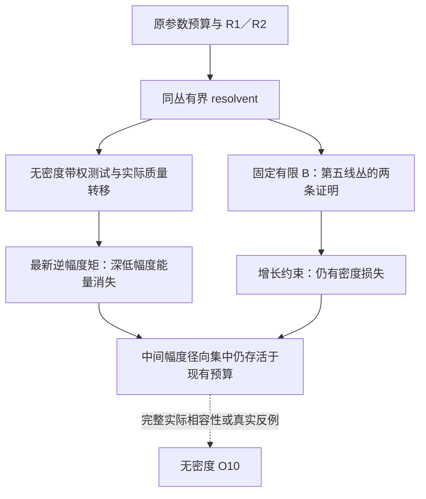
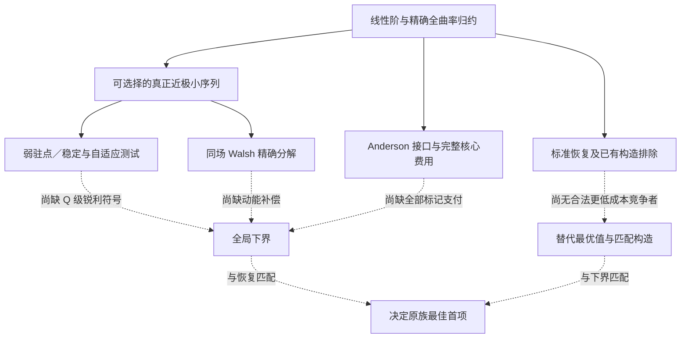

# 第一科学主线完整研究交接稿

**资料截止：2026-09-30，较早研究补全版。用途：回交原系统，从较早网页参与、共同深化与系统回流，连续承接至 O10/O11。**

**范围纠正：9月29日整合稿是此前多轮研究的汇合点，不是起点。**本版新增前置篇与10阶段原件登记，补回9月15—22日、9月26—28日的具体贡献、修正及继承；原来的当前主干与O10/O11专题全部保留。

## 交接结论与阅读方式

**无密度 O10 与原平衡族 O11 的最佳首项仍未得到完整证明，也未得到满足原全部条件的反例。用户要求的这两项最终加强没有完成，不能宣称最强版本已经闭合。**

但已有统一积分障碍、单解有限参数分析、N1 无迹 Ricci 回接、I40/I41 强制估计、四类经典供应应用和线性阶匹配均有对应证明稿。O10/O11 不进入这些已有定理的证明。应区分“更强版本尚未证明”与“已有主干自相矛盾”；目前材料支持前者，不支持笼统宣布后者。

本稿将同一理论的继承、两项攻关的成果与失败位置放在连续叙述中。它不新增数学定理，不以多个会话共同认可代替独立证明认证，也不声称穷尽至今全球文献。本次实际读取的是专题证明及其直接依赖，未逐式重证约 70 万 tokens 的全部整合稿。

**第一主线保持不变：实际规范场的拓扑信息，经场方程与曲率微分相容性，强迫无迹 Ricci 承担定量代价；再研究代价的适用范围、最优规模及真实实现。**

| 研究层次 | 此次交接保留的结果 | 尚未得到的结论 |
|---|---|---|
| 统一核心 | N1、类平方短缺版、I40/I41、旧 gap 回接与经典供应兼容 | 不把“存在证明稿”扩大成全部前置已独立认证 |
| O10 | 任意固定有限密度的证明链；无密度弱测试、实际质量转移、最新深低幅度估计 | 无密度统一常数或合法闭流形反例 |
| O11 | 线性阶、全曲率归约、完整普通类预算、弱变分选择、同场分解、完整核心接口 | 最佳首项；现有已知区间仍未缩小 |
| 关联分支 | 固定流形、慢模态、受限实现、物理接口及文献比较的完整存档 | 各自未完连接仍保留，不追加为本次两目标的必做条件 |

### 必须更新旧摘要的内容

- N1 容许类平方短缺的 $c/(1+y)$ 版本已经写出；旧摘要将其继续列为全未完成，已过时。
- 原 O11 普通复双曲吹起／柄族的完整经典类预算已经等于 $A$；仍未上控的是另一个 BF 连通和族。
- O10 已超出早期 $3/8$、$39/4$ 等固定阈值，达到每个固定有限 $B$；但常数依赖 $B$。
- 最新低幅度引理排除的是趋向零模长的最深层，不能据此删除中间幅度径向集中。
- Anderson 理论可以作为理想极小序列接口；未证的是原手术标记的完整支付，不能将 AE 费用施加于任意 ALE 气泡。

### 后期 O10/O11 集中攻关的增量（不代表全部研究起点）

| 阶段 | O10 增量 | O11 增量 |
|---|---|---|
| 较早完整阶段见下方前置篇；此处仅列截至9月28日的两题前置 | 单解参数与有限范围端点、固定外部延拓 | 线性阶、全曲率归约、替换、封帽和共形成本 |
| A | R1/R2 强电流与完整类型信息 | 真正近极小变分选择；原普通族完整经典预算 |
| B | 同丛 resolvent、谱阈值与第一延拓 | TT 修正、自适应测试、正曲率补偿 |
| C | 任意固定有限密度闭合；线丛陈类方法 | 全局变分接口、Codazzi 失败位置、构造排除 |
| D | 第五线丛弱 CR 核验、增长条件、完整径向相消 | 同场 Walsh 分解与构造限制 |
| E | 原误差幂次转接、无密度双重带权测试 | Anderson 接口、标记缺口、熵与整体构造检验 |
| F | 实际质量转移、完整径向一形式、重复预算检查 | 精确临界稳定性及三轴候选失败回执 |
| 最新外部附件 | 逆幅度矩与深低幅度能量排除 | Anderson／AE–ALE 适用范围再次核准，无新最优值下界 |

以上阶段名称是包内来源分组，不代表每一阶段均获得了全局主定理的同等增量。两项最终目标未解决的事实必须与所有阶段成果一起保留。

本稿先以新增前置篇恢复较早研究，然后保留四部分：第一部分固定当前主干；第二部分交接O10；第三部分交接O11；第四部分列出状态纠正和文献界面。最后附接续研究的准确入口。每处原 `outputs/…`、`upload/…` 路径均可通过本包 `sources/` 和 `04_Source_Index.md` 查找。

# 前置篇：更早的共同研究、思想形成与主定理升级

**9月29日《Integrated Manuscript》是多轮研究汇合成稿的节点，不是网页会话开始参与、深化第一科学主线的起点。**本次取得的9月15—22日和9月26—28日原件，已经显示更早的具体推导、审读、路线转向，以及网页与原系统之间的回流。

上一版确实保存了早期八卷和大量前置证明，但正文将这些阶段过度压缩成“已有基线”；另有独立早期稿没有收入。“档案中有旧原文”不等于已经把旧成果、思想演变和来源关系讲清楚。本篇补正这两层问题，不改写历史原件。

以下按正文所载日期、轮次和来源声明恢复脉络，不以文件修改时间推断发现日期，也不凭文件位于本会话工作区就认领首创。“原稿已证”表示找到相应命题与证明文本；本轮完成来源和继承核对，不等于重证全部分析。

## 0.1 全部交接范围与阶段

范围包括原题归一化、精确障碍与逼近退化、实际场积分自测试、参数和允许校准、四类经典供应、多实际类与周期、完整谱和慢模态、固定流形构造与受限实现、I40/I41、单解和N1，最后才是O10/O11集中攻关。

旧档案同时包含最初三条研究线。保留相邻线原件，是为保存第一主线依赖的构造、谱、拓扑与纠错来源；不将其所有结果改称积分障碍定理，也不因当前集中O10/O11就删除它们。

| 材料阶段 | 实际工作 | 后续继承 |
|---|---|---|
| 9月10日准备／状态审计及9月15日进展 | 原题量词、归一化、精确统一拓扑gap、逼近的必要退化 | 确定障碍与真实反例的输入、输出 |
| 9月16日归档与网页科学续接 | 纠正未闭合局部流；重数传输、校准密度重算、受控片准则；提出弱Bianchi直接测试 | 从局部流转向实际场直接分析，没有补完旧局部流 |
| 9月17日Fable审读与三线综合 | 纠正局部构造到固定闭反例的错误拼接、重复成果计数；保留旧gap | 保护全局量词，不把局部成功记成原题解决 |
| 9月21日十二轮研究与两版网页续稿 | 系统第3—5轮完成原度量积分gap；网页审读、抽取自测试模板与供给接口 | 无紧性积分障碍成为共同主干 |
| 9月22日第21轮后专论 | 允许根、联合预算、特征密度和联络分支的推导；37项文献接口 | 单一禁配点进入零端／KE端的参数结构 |
| 9月26日八卷审读、深化与执行稿 | 经典继承、多类联合判据、慢模态、三次扭率与特征类；明确零端与小h | 提供同解成本及后续消去机制的具体前置 |
| 9月26—27日网页—系统回流 | 系统I38/I39；网页混合项、模型消去与曲率关系；系统I40/I41 | 二次级下界升级线性；无迹Ricci强制 |
| 9月27—28日研究提交与重审 | 精确子族、完整核心、条件端点、流与锐性；单解、全曲率归约、N1及短缺版 | 旧gap严格回接更强参数核心 |
| 9月29日整合稿与其后A—F | 较早成果汇合；有限密度O10、无密度工具、O11变分与标记 | 后面专题章继续交接；两项最终目标未解 |

这不是等量贡献表。每个阶段须保留实际新增信息，不能以新文件或新公式数量代替数学增量。

## 0.2 第一次关键转向：精确障碍、退化局部流与原度量积分gap

早期同时研究点态Ricci夹逼与Einstein存在性。正负输入归一化、输入与输出度量、固定光滑流形与变化流形族必须分开。“存在某个Einstein度量”不等于“在输入度量附近存在同号Einstein度量”。这是后来固定E_D不能仅凭局部不可修复就成为原题反例的原因。

9月15日稿已记录精确Einstein的统一吹起间隙及逼近临界时必要的塌缩、直径发散。9月16日撤回或降级的是较一般近似流路线的共同时间、移动支撑、重启和终端紧性完成主张，没有撤销精确Einstein的旧gap。

9月16日网页A01续接稿给出具体数学：

- 带缓冲局部等距映射的重数传输引理，把底空间平均缺陷传到可能非单射的展开片；路径提升与缓冲仍为输入。
- 校准密度重算 \(\int\Phi_*\le119Q+912\pi^2Ad\) 及对应平均界。此处Q、d、\(\Phi_*\)沿该早期稿，不能与后来O11的Q混用。
- 受控谐和片上的密度传递准则，尚未从一般退化中自动供给该片。
- 弱Bianchi直接测试的替代方案：把Ricci导数转到受控测试张量上，绕开退化局部流。

9月21日审读对应的原系统第3—5轮，随后给出原度量积分gap。机制包括同一实际解的振幅、Hodge、方向及导数余项，有界旋量和光滑多项式Weyl模型，无统一Sobolev常数的Hessian预算，同场弱Bianchi自测试。网页又抽取有条件自测试模板，明确实际替代张量、二阶预算、正势和源项的职责。

**这应记为网页连接计算与替代思路、系统完整证明、网页继续审读和抽象之间的继承；不能全部归给任何一方，也不能把早期建议追认为当时已证明后来的定理。**

原来的
\[
\mathcal E+\left(T/A-\tfrac23\right)_+\ge\varepsilon
\]
由此成为后续主干。N1后来将支付加强为\(\mathcal J\)，不会抹掉这一步摆脱几何紧性的思想贡献。

来源：9月15日《最新进展与核心结果》；9月16日完整逐步归档和A01续接稿；9月21日审读证据包的round3_monopole_input、round3_rigidity、round4_rigidity、round4_all_sign_gap、round5_rigidity；两版9月21日第一主线TeX。路径见阶段登记与来源索引。

## 0.3 第二次展开：参数机制、实际供应和允许几何

9月22日网页专论不只是文献清单。它依据第21轮报告解释零Weyl根与KE根，提炼联合量\((1+B)d\)，给出\(B=o(d^{-1})\)的条件谱选择和幂次推论，重算
\[
4\pi^2(2\chi+3\tau)/V
=\tfrac23+\tfrac{16}{3}t^2+O(\sqrt d),
\]
以及负分支两允许根的联络曲率结构。只对拟合模型与对应输入成立，不是全部Einstein几何分类。

该稿当时未取得第13／21轮全部证明，因此其独立认证范围有限；后来八卷已收相应解析与chamber原稿。既不能让旧缺件声明永久覆盖新资料，也不能倒写历史审读范围。

9月26日以前已形成的成果应恢复为独立内容：

| 成果组 | 已有数学内容 | 不能删除的边界 |
|---|---|---|
| 原积分gap与同解余项 | 截断、光滑Weyl模型、无Sobolev Hessian、弱Bianchi | 形式上同调向量不替代实际解 |
| 实际供应扩展 | 普通／special monopole、正确chamber、BF、有限覆盖、Pin⁻ | 各供应者的正预算、类平方、取向和量词分别验证 |
| 参数和双侧窗口 | 有限参数非饱和、能量上下壁、双手性预算、允许KE与零端 | 不虚构另一手性解；有限参数不自动给统一零端 |
| 允许端正向供应 | 从实际β=2输入产生有界形式、harmonic Chern对齐和微分预算；后续删标量带假设 | 近允许结构不自动精确存在 |
| 多实际类与周期 | 交叉矩阵、符号相关、相位切换成本、正惯性和多个慢标量模态 | 和差不自动可解；投影界不自动使整个周期平面紧 |
| Kähler等号与变分量 | 区分负cscK与KE、保留primitive超额；Ricci能量到缺陷的条件接口 | 不同泛函下确界不能相减；标量一致性不能省 |
| 变幅与有符号谱 | 振幅导数、实际源项、负最低特征值能量平衡及条件幅度界 | 正最大特征值刚性不能直接翻号 |
| 拓扑排泡与实现 | aspherical／π₂到ALE排除；各自受控条件下KE、双圆盘、复双曲实现 | 条件不同；去直径未全部完成 |
| 修复、覆盖与塌缩主体 | 覆盖度无损下降、一致局部逆、全张量强制、rewound产品主体 | 高模逆不解决全部低模；主体不自动决定坏集拓扑 |
| 完整带标记填充 | 实际harmonic场非消失、A1/Wahl/Milnor匹配、尺度代价与条件平滑 | 终端泡不替代整个填充；全局平滑需另证 |

四类经典工作在这里负责实际供应及既有曲率约束，共同分析负责新的定量非饱和与强制。恢复的是匹配条件下的相应定理，不是笼统包含四篇论文的一切内容。

来源：早期八卷01—06与Atlas的核心、经典继承及实现附录。9月22日专论的37项文献和查阅范围完整保存；后文当前接口表不替代该历史调研，也不表示37篇全部重新全文核验。

## 0.4 构造、完整谱与慢模态已有成果，不能只剩开放问题名称

固定E_D已有同一闭光滑流形上的全局近负Einstein构造，含全部Ricci块、混合项、单值与拓扑识别。在相应模型中\(\delta_-\to0\)，体积为\(16\pi^2(p-1)(q-1)\)，注入半径趋零、直径发散；指定双genus-2情形才为\(16\pi^2\)。未完成的是它是否承载任何负Einstein度量。无Kähler、指定ansatz不可修复或泛函不取到不能独自排除所有候选。

完整张量谱已识别Teichmüller值慢场，而非几个腰部参数。原稿在相应产品规范下给
\[
\operatorname{gap}=\min\{3,\lambda_1(B)/2,\lambda_1(F)/2\},
\]
并研究一致高模逆、低模Schur反馈、完整可积核、循环覆盖的\(m^2\)逆损失及其锐性、固定振幅慢路径的全Ricci计算与非线性模空间能量。这些是已有数学产出。

缩小邻域的全模修复不能扩大为固定大小邻域修复；固定振幅构造对保纤维产品的分离不能自动扩大到所有Einstein。实际回路导出的有限／可约单值及薄版本，也不等于一般近Einstein自动纤维化或全部可约拼接已经完成。

这些工作检验近似与精确存在之间的距离，应完整保留，却不重新变成此次O10/O11的强制前置。来源为早期八卷07—08、完整产品／扭曲算子原稿、integrable kernel与nonlinear slow-moduli稿及固定流形长稿的指定摘录。

## 0.5 第三次关键跃迁：网页新推导与系统I40/I41闭合

9月26日《研究主线深化与证明方案》恢复四类经典关系，并给出具体推导：

1. Chern–Weil组合
   \[
   D_2+72\pi^2(p-T_+)+54W_-
   =18P+144\pi^2(\chi-3\tau).
   \]
   此处\(W_-=\int|W^-|^2\)。这是已有恒等式的组合，不另算独立曲率下界。
2. 无第一特征值下界的多实际类联合PSD测试、多个正方向迫使多个慢模的条件推论。形式矩阵分离仍需真实可解类配置；标准BF符号集合不自动给新分离实例。
3. 固定E_D所有Einstein候选体积窗口、完整核、完整核心和精确实现条件的区分。

同日《下一阶段并行研究执行书》已把主攻写成“零端闭合与小h真实阶数”。它定义全局光滑三次扭率\(t_\Phi\in S^-\otimes L\)，计算
\[
c_2(S^-\otimes L)[M]=\frac{9a^2+2\chi-3\tau}{4},
\]
并给低幅度与标量松弛推导。进一步扭率关系、零集全局支付及一般间隙当时待证，不能把执行稿全部算已完成，也不能全部降为意见。

系统I38/I39随后给同解拓扑成本和临界集中。9月27日网页《临界混合项核查与续推》新增带径向／相位的Chern transgression、临界混合成本、模型作用消去\(K(W_0,\Phi)=0\)、改善的实际扭率Dirac误差及同解反手性曲率关系。

**系统I40原稿明确保留网页归属：§§1—3承接混合项、模型消去与曲率关系；系统新增§§4—5的Hessian–Bianchi闭合。**在Hessian预算中消去相容KE背景，把剩余联络能量放回同场弱Bianchi吸收，才得到小h二次级到线性级的升级。I41再以共形恒等式去掉标量方差支付，得到无迹Ricci强制与实际BF线性窗口。

继承链是：**网页深化／执行 → 系统同解成本 → 网页混合项与模型消去 → 系统Hessian–Bianchi闭合 → I41 → 单解、全曲率归约、N1 → 9月29日整合。**

这是来源和续接关系，不表示每个后续证明必须调用前面的全部内容。独立网页稿与系统引用名内容对应且原稿明示归属；尚未取得改名接收回执独立JSON，不额外断言两条命名路径逐字节相同。全部归给任一方都不符合原文。

## 0.6 从线性强制回到统一主定理，再进入两项集中攻关

9月27日提交还包含指定子族精确值、条件零端、实际商核心、I47完整核心费用、受限椭圆／驻点端点、有限光滑时间流检验与X06锐性。它们各自有增量，不能因为没定O11首项就一律降为无效工具，也不能据此宣布一般最优值已确定。

9月28日具体推进包括全曲率有限参数比较、真正近极小转移、无预紧单元替换、任意共形有符号平方、封帽评分、固定外部延拓成本与普通单解输入。替换控制过贵而不排除过便宜；固定外部估计不覆盖共同退化，范围随结果保留。

N1在β=8严格回接旧gap，将支付从\(\mathcal E\)加强为\(\mathcal J\)，随后又有类平方短缺的\(c/(1+y)\)版。它们是真实增强，早期“未回接”“N1不能容许短缺”已过时。

完整思想链因而是：**精确拓扑障碍与退化 → 实际场弱自测试的原积分gap → 参数与供应扩展 → 校准背景消去的线性强制 → 单解和N1 → 端点完整性与最优性。**

9月29日稿保存的是此前已经发展的理论。A—F及最新附件是后续增量，不能替代全部前史。无密度O10和O11最佳首项仍未完成；后来有限密度O10也不能倒写成9月26日已完成。

## 0.7 补取原件与仍然存在的覆盖边界

本次找回9月26日接收说明中曾列为未取得的五项独立原件：9月21日三篇“积分刚性／近Einstein构造／全局判定”TeX、十二轮原稿审读MD及其审读复算证据ZIP。已原字节保存，旧说明的缺件状态由本篇更新。

还补入上一版漏收的9月26日深化报告、并行执行书、9月27日临界混合项独立稿。External Review全文原已嵌第09卷，本次增加独立入口，不重复计新数学。未署日期的joint_fields过程稿已被深化报告吸收，不凭名称猜日期或另计定理。

历史原文不删改，当前继承纠错包括：

- restricted IL近似流的过强完成主张被撤回，不影响旧精确统一gap。
- 直接积分证明绕过SC／局部流，不表示补完旧流路线。
- 二次级下界已被I40/I41线性阶加强；N1及短缺版已严格回接。
- 有限密度O10、普通原族完整经典预算等采用后面专题的最新状态。
- 形式矩阵、形式集中、局部核心和合法测试不自动成为全局反例或锐利下界。

目前仍不能声称取得全部私人Git历史、所有未上传对话、长稿未选部分以及每份接收回执。本次新增来源含重复版本、相邻研究和被替代的工作笔记，文件数不是独立定理数。记录在06_Earlier_Stage_Register.json、04_Source_Index.md、SOURCE_MANIFEST.json及EARLY_ARCHIVE_MEMBERS.json。

本篇与后面的当前主干、O10、O11专题共同使用，才能恢复用户要求的较早共同研究与后续攻关全过程；不能再以两项终点攻关的时间范围代替整条主线的研究范围。

---

# 阅读图谱

实线表示来源稿中已有的推导或使用关系；虚线表示仍缺的数学连接。各节点依原命题的假设使用。图示不是对全部前置分析的新认证。完整关键节点与来源见 `02_Claim_Ledger.json`；早期全量图谱位于 `sources/outputs/Line1_Atlas_20260928/01_Knowledge_Graph.json`。

## 共同主干

经典非消失理论负责真实输入，共同分析负责新增强制。N1 与 I40/I41 的结论不同，均须保留。旧积分 gap 已由 N1 严格回接，不再只是平行陈列。

## O10：有限密度以后

有限密度两条证明的具体前置不同，不能因终点相同便强行串成一条必经链。无密度工具未给出 \(dm\to0\) 或第五线丛截面的全部质量保留。

## O11：已有工具与真正缺口

O10 的 (o(V)) 信息不自动具有 O11 的 (o(Q)) 精度；两项没有“先解 O10 就自动解 O11”的已证箭头。Anderson 路线是可用选择，不是 O11 强制采用的方法。

## 不可误画的五条箭头

1. \(\forall B<\infty\ \exists c(B)>0\) 不推出 \(\exists c>0\ \forall B\)。
2. 深低幅度能量消失不推出所有径向能量消失。
3. 近驻点／近稳定不推出全局最佳系数。
4. 一般 ALE 二周期不推出普通 AE 的 \(8\pi^2\) 无迹 Ricci 费用。
5. 两个加强目标未解不推出已有 N1／I40／I41 证明失效。

---

# 第一主线的固定基线、共同机制与成果继承

整理日期：2026-09-30（北京时间）。本章负责保留进入 O10/O11 集中攻关之前的主干与关联成果；9 月 29—30 日的 O10/O11 增量以本交接的对应专题章为准。**不得将本章引用的旧版开放状态覆盖到较新的专题状态上。**

本章依据实际读取的图谱、继承证明、续研审读及整合稿相关段落整理，不新增定理。下文“已有证明稿”表示来源中确有命题与证明，并标出其依赖；不等于本次重新完成全部上游 PDE 证明的独立认证，也不等于全球原创性认证。

## 1. 核心研究对象始终是同一套定量相容性理论

**第一主线研究：实际规范场提供的拓扑信息，如何通过场方程与曲率微分恒等式的共同相容性，强迫 Einstein 缺陷承担不可消除的积分代价；再判断这种代价的适用范围、最优尺度和几何实现。**

这条主线的原创性候选不只是“某些流形没有 Einstein 度量”，也不只是“得到某个系数”。它保留产生经典曲率预算的同一个实际场，追踪其振幅、方向、导数、联络与拓扑类。某组数值可能分别满足 Chern–Weil 和经典曲率不等式，却仍不能由同一度量、同一实际场实现；新增限制应当来自这种微分相容性。

共同分析链包含：

1. **实际输入。** 使用普通 SW、special monopole、BF 或 Pin-minus 等真正供应者，取得一个满足指定投影与类平方预算的实际场。形式上合适的上同调向量不够。
2. **保留余项。** 不只取 Weitzenböck、Hodge 和标量—Weyl 不等式的最终数值，而保留同场非负误差及其参数尺度。
3. **有界场与二阶控制。** 振幅截断、多项式 Weyl 模型和有界截面的 Hessian 恒等式，避免预设统一 Sobolev、曲率导数或几何紧性。
4. **相容背景消去。** I40 在允许的 KE 校准端，利用大背景曲率对实际旋量的作用消去，避免把整个非小背景都计为误差。
5. **同场弱 Bianchi 测试。** 将拓扑控制的联络能量、模型导数和无迹 Ricci 误差放入同一个强制估计。
6. **精确共形转移与实际应用。** 在负 Yamabe 代表上完成分析，再以积分恒等式回到原度量；对各供应者逐项验证量词、取向及预算。

经典工作已经包含实际方程、等号几何和锐变分，不能被概括为“只有拓扑代数”。项目应比较的新增量是：定量非饱和、无额外几何紧性的范围、无迹 Ricci 的线性支付，以及真实新增应用。

## 2. 统一记号与不可删除的量词

设 \(M\) 是闭、连通、定向光滑四流形，采用项目的曲率算子 Hilbert–Schmidt 范数规范。定义
\[
T_+=2\chi+3\tau,\qquad T_-=2\chi-3\tau,
\]
\[
P=\int_M|\operatorname{Ric}^{\circ}|^2,\quad
R=\int_M|\operatorname{Ric}|^2,\quad
S_2=\int_Ms^2,\quad V=\operatorname{Vol}(M).
\]
这里 \(T_+\) 的下标表示手性组合；\((x)_+=\max\{x,0\}\) 才表示正部，两者不可混写。

当 \(R>0\) 时，
\[
\mathcal J=\frac{4P}{R},\qquad
\mathcal E=\inf_{\lambda\ne0}
\frac{\int|\operatorname{Ric}-\lambda g|^2}{\lambda^2V}
=\frac{4P+\int(s-\bar s)^2}{R},\qquad
\mathcal E\ge\mathcal J.
\]

负 Yamabe 共形类取 \(s_{\widehat g}=-4\) 的代表。新单解输入是：该代表上存在一个实际普通 SW 解
\[
D_{A_{\rm conn}}\Phi=0,\qquad F_{A_{\rm conn}}^+=2i\sigma(\Phi),
\]
同一 Spin\(^c\) 结构的类 \(a\) 满足
\[
p=(a_g^+)^2=(a_{\widehat g}^+)^2\ge A>0
\]
及相应类平方条件。本文用 \(A_{\rm conn}\) 区分联络与拓扑预算 \(A\)。

逐度量结论只需要该共形类中的上述输入。全度量结论需要
\[
\forall[g]\quad\exists\,(a,A_{\rm conn},\Phi)
\]
并共用所需的正下限 \(A\)。允许不同共形类选择不同结构；每次推导中的 \(p,a^2\)、实际场和误差必须属于同一结构、同一解。不能从一个度量存在解推出所有度量可解，也不能把不同解的余项拼接。

旧版全共形、全所需权重供应者确实进入新输入：若它允许非负常标量代表，SW 的 Weitzenböck 恒等式将迫使旋量及 \(F^+\) 消失，与 \(p>0\) 矛盾。因此旧适用共形类为负，负 Yamabe 单解不是后来额外附加的限制。

## 3. 已有核心结论及严格继承关系

### 3.1 原积分 gap 经 N1 加强为无迹 Ricci gap

在上述单解输入及 \(a^2\ge T_+\) 下，来源已给出
\[
\boxed{\mathcal J(g)+\left(\frac{T_+}{A}-\frac23\right)_+
\ge\varepsilon>0.}\tag{N1}
\]
常数不依赖直径、非塌缩、全局 Sobolev 常数、点态曲率或驻点方程。由 \(\mathcal E\ge\mathcal J\) 严格恢复并加强最早的统一积分障碍。

这是明确的证明连接，并非将新旧结论并排陈列。单解参数泛函为
\[
D_\beta=(1+\beta^{-1})S_2+6(\beta+1)\int|W^+|^2-72\pi^2p.
\]
在 \(\beta=8\) 时，
\[
D_8=108\pi^2(T_+-2p/3)+\frac{27}{2}P.
\]
单解有限参数估计和标量预算，先在 \(s=-4\) 的代表上给
\[
\frac{43}{16}\frac PV+\frac{27}{4}
\left(\frac{T_+}{A}-\frac23\right)_+\ge c_8.
\]
令 \(\delta=S_2(g)-S_2(\widehat g)\ge0\)，精确共形式为
\[
P(g)=P(\widehat g)+\delta/12,\qquad
R(g)=R(\widehat g)+\delta/3.
\]
所以 \(\mathcal J(g)\) 是 \(\mathcal J(\widehat g)\) 与 \(1\) 的加权平均，得到
\(\mathcal J(g)\ge\min\{\mathcal J(\widehat g),1\}\)。这不是小共形扰动论证，也不表示所有共形变化都使 \(\mathcal J\) 单调增加。来源所用常数可写为 \(\varepsilon=\min\{1,c_0/768\}\)，未声称最优。

**状态更新：有界类平方短缺的 N1 版本已有完整推导。** `03_N1_Complete_Inheritance.md` 保留 I51 的类平方成本，得到
\[
\boxed{
\mathcal J(g)+\left(\frac{T_+}{A}-\frac23\right)_+
\ge\frac{c}{1+y},\qquad y=\frac{(T_+-a^2)_+}{A}.
}\tag{N1-Y}
\]
它仍需要同一负 Yamabe 实际解与 \(p\ge A>0\)。有界 \(y\) 范围不应重新登记为待证；任意无界 \(y\) 下的无损常数和最佳短缺依赖尚未确定。该状态晚于只保留 \(a^2\ge T_+\) 的早期 N1 文件，应由较新继承文件覆盖。

### 3.2 I40/I41 给出另一个精细分支：线性拓扑代价

令
\[
\Sigma=S_2-32\pi^2p,\quad
\Pi=P+D_2,\quad Y=(T_+-a^2)_+.
\]
I40/I41 及单解补充在其陈述范围给出
\[
\boxed{\Sigma,\ (p-T_+)_+
\le C\{\Pi+\sqrt{\Pi Y}\}.}\tag{LC}
\]
这里两个输出可用不同普适常数，常数中吸收固定范数归一化。I40 的关键是删除背景 \(O(V)\) 损失；I41 的关键是精确共形归约，使强制代价由无迹 Ricci 本身承担，不能全部藏于标量方差。

与另一手性的 Chern–Weil 上预算结合，在对应双手性窗口有
\[
\mathcal J+(U-1-h)_+\ge ch.
\]
类平方短缺在该窗口的损失为 \(c h^2/(h+y)\) 型；若 \(y\le Lh\)，仍保留线性阶。这与 N1-Y 的临界阈值短缺式是不同输出，不可混同误差尺度。

有限参数分析、\(\beta=8\) 的 N1 与 \(\beta=2\) 精细机制共同构成统一核心。只保留小 \(h\) 线性窗口，不能代替原 \(T_+/A=2/3\) 障碍；N1 也不替代 I40/I41 的精细线性信息。

### 3.3 单解输入、参数包络和双手性应用已经累积升级

单解补充从
\[
\Sigma=16\int|\nabla\Phi|^2+4\int(\rho-2)^2+8J_+,
\quad \rho=|\Phi|^2\le2
\]
及同一解的参数分解、低幅度测试、Hessian 和弱 Bianchi 估计，闭合有限参数与线性强制。因此相应证明不再需要调用全部辅助权重的解。**这一分析输入削弱已完成；由此产生严格超出旧供应者的新自然对象尚未完成。**

旧参数包络、上下能量壁、双手性二次窗口及其 BF 应用仍保留。相同已覆盖小 \(h\) 范围内，二次下界被线性下界加强；其他参数范围和不同输出不能只因编号较早就删除。I51 将紧化端已知衰减改善，但其有限参数量为 \(D_\beta/(\beta V)\)，不等同 O10 的 \(D_\beta/V\)。

### 3.4 正预算与 Ricci-flat 边界

全套正预算结论必须保留 \(A>0\)。Ricci-flat 时 \(R=0\)，\(\mathcal J\) 不定义，而原 \(\mathcal E\) 定义给 \(4\)，不能将它写成所有 Einstein 度量都令两个泛函为零。在实际正投影全度量应用中，应另用
\(\int s_-^2\ge32\pi^2A>0\) 排除 Ricci-flat。零预算、零手术角点可能有 K3 等 Ricci-flat 例子。

## 4. 四类经典工作的真实继承，不是作者名单

“包含前人”应表达为：**经典非消失或实际供应定理作为输入，加上本项目共同定量分析，推出对应障碍及其明确加强。** 不代表本项目重证或包含原论文的所有定理。

| 经典供应链 | 必须保留的真实输入 | 已有对应加强 | 不可删去的边界 |
|---|---|---|---|
| LeBrun 极化手术框架 | 基底普通 SW 非消失、所需插入；\(b_+=1\) 保留正确 chamber；吹起及添柄符号选取得 \(p\ge A\)、\(a^2\ge T_+\) | 原积分 gap、N1 无迹 Ricci gap、对应定量近 Einstein 障碍 | 不由此自动推出其全部最小 Ricci 能量或最小体积定理；正预算与零角点另分 |
| Kotschick special monopole | 真正对所需度量有解的 monopole class，加 special 条件 \(a^2\ge T_+\)；正平方时可取 \(A=a^2\) | 在匹配正预算范围加入统一积分和无迹 Ricci 排斥 | 任意 monopole 不自动 special；special 也不自动正平方；不是另一篇 entropy 论文 |
| Ishida–LeBrun／Bauer–Furuta | 适用的 2 或 3 个辛块、\(b_+\equiv3\pmod4\)、BF 非消失与 geography 条件；\(A=\sum c_1^2(X_i)>0\) | 普通 SW 不足以供给的连通和仍有实际解；N1 与 I41 真实线性窗口 | 任意连通和不自动有供给；四块情形不能不加额外条件照搬；已知符号类不是全部 monopole 类 |
| Ishida–Matsuo–Nakamura Pin-minus | 非平凡双覆盖、局部系数、真实 Spin\(^c_-\) 结构与扭曲解；提升成普通实际解 | 归一化 N1、I41 可在覆盖上应用再下降，保持常数 | 只需底空间度量的拉回及相应不变输入；不要求也不推出覆盖上一切非不变度量可解 |

Pin 覆盖中 \(p,a^2,T_+,A,P,R,V\) 同乘覆盖次数，\(\mathcal J,\mathcal E\) 与归一化短缺不变。原图谱还保留 ordinary SW、ordinary BF 为零而 Pin 供给有效的真实族。这些旧 Pin 新对象不能再当作“本次单解削弱首次产生的新对象”。

主要一手文献入口（供继承核查，**本次未重新逐篇浏览**）：

- LeBrun, *Ricci Curvature, Minimal Volumes, and Seiberg–Witten Theory*, arXiv:math/0003068。
- Kotschick, *Monopole Classes and Einstein Metrics*, arXiv:math/0306022。
- Ishida–LeBrun, *Curvature, Connected Sums, and Seiberg–Witten Theory*, arXiv:math/0111228。
- Ishida–Matsuo–Nakamura, *Yamabe Invariants and the Pin-minus(2)-monopole Equations*, arXiv:1505.05948。
- 供应链另保留 Ozsváth–Szabó 插入与手术、Li–Liu chamber、Bauer 非消失、Braungardt–Kotschick geography；它们是外部输入而非项目原创部分。
- 全曲率及完整凸几何比较保留 LeBrun arXiv:math/0404251 等。两个独立泛函下界不能相减产生 \(P\) 下界。

**BF 完整预算仍未上控。** 原稿计算的是明确供给符号集合 \(\mathcal C_0\) 的经典优化预算 \(A\)。新窗口超出这组类的相应经典判据，不等于超出全部可能 monopole 类。未知类如增加 \(O(Ah)\) 的预算，可能改变“这些光滑类型首次被排除 Einstein”的历史比较。精确到 \(o(Ah)\) 的完整上控仍应保留，但它不是 N1 或 I41 本身的证明假设。

## 5. 原平衡族与 O11：已有成果到哪里为止

对象固定为
\[
M_j=X_j\# k_j\overline{\mathbb{CP}}^2\#\ell_j(S^1\times S^3),\quad
A_j=c_1^2(X_j),\quad Q_j=k_j+4\ell_j,\quad h_j=Q_j/A_j\to0,
\]
其中 \(X_j\) 是原构造的复双曲基底，
\[
k_j/Q_j\to2/9,\qquad \ell_j/Q_j\to7/36.
\]
已给出真实恢复构造及
\[
c_1h_j\le\alpha_j:=\inf_g\mathcal E(g)
=\inf_g\mathcal J(g)\le\frac{4h_j}{1+h_j}
\]
（中间等号在原小 \(h\) 族充分大指标的次单位范围）。因此线性阶已经确定，尚未确定的不是“是否线性”。

9 月 28 日续研给出不要求极小值取得的比较
\[
\frac{4\varrho_j}{U_j+4\varrho_j}\le\alpha_j
\le\frac{4\varrho_j}{1+\varrho_j},\quad
\varrho_j=\frac{\inf_gP(g)}{8\pi^2A_j},\quad U_j=3T_-(M_j)/A_j.
\]
原平衡族因而有
\[
\alpha_j=4\varrho_j+O(h_j^2).
\]
曲率算子规范下
\[
\int|\operatorname{Rm}_{\rm op}|^2=8\pi^2\chi+P.
\]
这把 O11 严格归约为全度量最优全曲率的一阶问题，且常标量代表上的相应近极小序列可在 \(o(Q_j)\) 精度转移。候选系数 \(4\) 等价于
\[
\inf_gP(g)=8\pi^2Q_j+o(Q_j).
\]
原族若存在更便宜的真实几何，同样是合法答案；不能预设 \(4\) 再只寻找支持证据。

与这个全局未定问题不同，已有真正全度量精确子族：只添柄 \(k=0\)、\(0\le h\le1/3\) 时 \(\inf\mathcal E=4h/(1+h)\)；相应 \(0<h<1/3\) 不取到。\(k=o(Q)\) 也有渐近首项 \(4\)。它们不能替换 \(k/Q\to2/9\) 的原平衡族。

## 6. 不应丢掉的结构、构造与早期思想

以下项目是主线的已有关联分支或工具，不是全部由一条障碍公式直接推出。完整假设、编号及原证明见图谱附录，接收系统应按用途调用。

| 成果组 | 已有证明稿中的作用 | 适用边界 |
|---|---|---|
| 独立有界自对偶形式准则、允许 Weyl 模型 | 将实际供应与解析相容性区分；识别允许的 KE 校准、零 Weyl 端及正负号差异 | 一般形式输入不自动由任意流形供给；零端并非近平行端 |
| 多实际类、周期、交叉配对及正惯性 | 保留多类共同几何信息和 Kähler 边界 | 形式 Gram/PSD 证书不自动超出经典预算；供应者必须真实 |
| I44、I52、I53：精确子族、稳定与封帽 | 只添柄精确值；受控规范中的 \(Q\) 尺度稳定；小能量完整标记环带的匹配帽；总封帽评分 \(o(Q)\) 的充分接口 | 环带与规范不能自动从任意竞争序列取得；内禀圆边界不等于便宜完整领口 |
| I54、I55、替换引理、共形恒等式 | 任意内部完整单元、外部预算与稀疏植入；近极小序列不能保留正密度过贵单元；任意振幅共形改变的准确成本 | 过贵单元可消除不等于过便宜单元不存在；外部一起退化的竞争者未被自动覆盖 |
| I47 完整核心 | 指定物理取向、\(1/n(1,-2)\) 锥领口和完整光滑填充下，特定混合曲率泛函有锐利成本 | 不是任意 ALE 全曲率收费；不能按终端气泡逐层重复计费，也不自动提取全部拓扑 |
| 受控精确 Einstein 实现 | \(\pi_2=0\)、相应直径/体积/Ricci 条件下无泡与实现；双侧饱和产品实现；陈数边界复双曲实现 | 这些全局条件各按原定理保留，不能由障碍消失直接推出 |
| 覆盖、塌缩、轨形与填充 | 覆盖兼容、局部产品 bulk、相容整填充及 Q-Gorenstein 平滑后的负 KE 构造 | 局部模型、辛填充、复平滑和同一光滑类型的精确输出是不同步骤 |
| 全局单值与慢模态 | 回路变形、厚/薄纤维、有限或可约 monodromy、保留完整核的修复及真实慢模态 | 逆估计的覆盖损失有真实例子；局部误差小不等于接近单一背景 |
| I49 变分流与 X06/X09/X10 | 有限光滑流寿命、固定基底规范失败、某些自动 bulk 选择失败、Weyl 支付不可删的真实例子 | 流失效或局部修复失效不是全部 Einstein 不存在；这些例子未否定原 O10/O11 |
| 局部高指数实际核心与固定外部延拓 | 识别某些弱预算失效、简单零分裂、延拓到固定受控外部的发散成本 | 局部实际解没有闭流形全供应、全部过渡与全局类平方预算，不是 O10 反例 |

数值回执保存全部成功、未收敛及未达容差的记录。有限径向搜索未找到低于阈值的候选，不构成全类下界；代数脚本与编译通过不替代椭圆分析、拼接或拓扑证明。

## 7. O10/O11 与论文闭合的准确关系

9 月 29 日整合稿第 25 节 `Endpoint and extremal questions` 明写：这两个问题**不进入有限参数分离和线性强制定理的证明**。

- **既有主干层：**在各自明写假设下，N1、参数分析、I40/I41、实际应用及线性阶已有连续证明稿。不能因更强终点未解，就推断这些定理互相矛盾、此前成果失效或全部投入白费。
- **用户要求的两项目标层：**无密度 O10 及原平衡族 O11 最佳首项尚无完整答案，不能宣布该加强计划成功。要在论文中主张“一般端点完整”或“该原族渐近最优”，相应证明确实必须补齐。
- **研究整体层：**精确实现、新供应者及完整经典比较还有各自问题；解决两项目标也不等于一般 Yau26、全部 Einstein 存在性或一切可能推广已经完成。

O10 要求控制体积 \(V\) 尺度的净缺陷；O11 要精确到 \(o(Q)\)，\(Q=Ah\)。\(o(V)\) 不是 \(o(Q)\)。完整泡树、普遍 \(\Gamma\)-极限和全部近极小分类可以服务证明，但不是额外强制验收项目。

关于 O10 的有限密度版本及近期不依赖 \(W^-\) 预算的工具，应读取后续专题章；本章不沿用 9 月 28 日尚未完成有限密度版本的旧状态。

## 8. 仍需保留、但不加入本次两目标验收的工作

| 问题 | 已有基础 | 仍未完成的准确内容 |
|---|---|---|
| 新单解供应者 | 输入已削弱，旧普通、BF、Pin 兼容已完成 | 一个严格超出旧供应链的自然对象，以及逐共形类实际预算和新结论 |
| BF 完整经典预算 | 已知符号集合的优化预算精确为 \(A\) | 全部可能 monopole 类预算在 \(o(Ah)\) 精度的上控，或足够准确的历史贡献限定 |
| 固定 \(E_D\) 全部负 Einstein 存在性 | 固定单 Dehn-twist 曲面丛上已有 \(\delta_-(g_j)\to0\) 的构造 | 证明同一个光滑流形承载某个负 Einstein 度量，或排除所有候选；不能只排除一个修复邻域 |
| 去直径的陈数边界实现 | I26 在 \(A=T_+=3T_->0\)、实际投影预算及直径控制下已有复双曲实现 | 删除直径后，同光滑类型的全局收敛、标记保持或实际构造；数值饱和不代替端部填充 |
| 低模态与全局转移 | 可积完整核的修复、慢模态及有限/可约单值分支 | 一般输入如何供给全局纤维/转移；可约分支的真实 Einstein 匹配；固定幅度全输出覆盖 |
| 轨形至相容整填充 | 受限全局平滑、实际形式与领口匹配 | 从原弱输入自动得到所需核心标记、全局可平滑性及同光滑类型识别 |

整合稿给固定 \(E_D\) 构造的体积为
\[
V=16\pi^2(p-1)(q-1)
\]
（纤维和基底属数 \(p,q\ge2\)）；\(16\pi^2\) 只是两者属数均为 2 的特例。变动拓扑积分趋零与固定流形逐点逼近必须分开。

还保留更一般自对偶形式零端、联合类新供应者、上能量壁与新拓扑非存在的连接、N1 最佳常数及最佳短缺依赖。这些不应被同时升级为此次系统接手 O10/O11 的必做欠账。

## 9. 物理与外部大问题的保留位置

物理交接已写出五组明确的下游公式：正耦合二次曲率作用量、Einstein–matter 无迹应力、Maxwell 两手性重叠、Levi-Civita 手性块、一圈 RG 去整体尺度残差。它们使用原几何假设，并分别保留真实耦合解、边界、最优性和模型范围；不是 O10/O11 的证明前置。

对已受原几何定理约束的 Einstein–Maxwell 度量，可以把 SW 作为独立几何探针应用 \(P\) 下界，不必把 SW 旋量改称电磁场。反过来，只有 \(P+D_2\) 下界时，不能直接宣称单独的应力下界。

Energy Finiteness、Ricci-flat ALE 分类、ALF Hermitianity、Goldberg、AdS、BPS 等早期连接保留为研究比较，未形成这些猜想的一般解决，也不因对象相邻就登记为直接部分解决。特别是 I47 的泛函不含完整 \(W^-\) 能量，其每个指定核心成本不自动量化所有拓扑复杂度；无限拓扑不自动提供无限多个满足其完整领口合同的互不相交核心。O10 对实际退化场的研究与精确 almost-Kähler 刚性定理也须区分。不得将早期“高度匹配”“结构同构”“几乎同一句话”等研究判断继承为数学证明。

## 10. 本章实际读取的来源与核验范围

工作区相对路径如下；主交接包的清单负责映射到归档位置。

1. `outputs/Line1_Atlas_20260928/00_Line1_Research_Atlas_20260928.md`：主中心、五层结构、继承和各开放问题。
2. `outputs/Line1_Atlas_20260928/03_N1_Complete_Inheritance.md`：N1 完整回接、旧输入到新输入、覆盖、Ricci-flat 边界、短缺版证明与 BF 比较范围。
3. `outputs/Line1_Atlas_20260928/appendices/01_Core_and_Development.md`：共同分析及早期演化（本次重点读取主核心部分，未重新重证所有附带原稿）。
4. `outputs/Line1_Atlas_20260928/appendices/02_Classical_Inheritance.md`：四供应链、经典原文位置、正预算边界及完整类预算缺口。
5. `outputs/Line1_Atlas_20260928/appendices/04_Geometry_and_Variation.md`：I42–I55、X06/X09/X10、真实构造、数值记录及误用边界。
6. `outputs/Line1_Atlas_20260928/appendices/05_Realization_and_Global_Structure.md`：允许结构、紧致实现、覆盖塌缩、慢模态和整填充。
7. `outputs/Line1_Atlas_20260928/appendices/06_Physics_and_Literature.md`：五组物理推论、模型边界及引力瞬子联系的纠正。
8. `outputs/Line1_Atlas_20260928/appendices/07_Open_Problems.md`：独立实现与其他未闭合接口；其 O10/O11 旧状态由新专题覆盖。
9. `outputs/Qiushi_Line1_Unified_Gap_20260928.md`：原 N1 补充稿；短缺版状态以后来的第 2 项为准。
10. `outputs/Qiushi_Line1_Continuation_Review_20260928/00_Research_Report.md`：全曲率归约、替换、共形恒等式、封帽评分、固定外部延拓及单解输入。本次未重新逐式审读其全部八份证明附录。
11. `upload/27b3cef6-aeed-442c-9e66-fef1a757828e.tex`：本次直接读取 `Endpoint and extremal questions`（原文件约第 9884–9977 行），核准主干与两目标的依赖、固定 \(E_D\) 体积及其他问题范围；未声称通读或重新认证约 70 万 tokens 的整稿。

图谱归档还保存早期八卷、后续十二卷、物理交接及核查来源。图谱登记的 79 与 47 是来源条目数，存在重复和版本继承，不能相加称为独立定理数。本次不删原来源，也不以本章摘要替代完整证明。

未在本章重新完成的工作包括：全部外部文献的最新版本核查、所有原稿逐式认证、完整 BF 类枚举、未曾取得的会话/文件恢复，以及原创性的穷尽性判断。缺失或未重读的材料只能按现有来源标记继承，不得补造结论。后续若发现实际证明缺口，应准确回退相应节点及其依赖；不能用笼统的“全已认证”或“全部失败”代替逐项判断。

---

# 02　O10：一般弱积分零端的完整续研交接

本章整理从原系统整合稿，到本会话 A—F 轮、其他网页会话上传文件及 2026 年 9 月 30 日最新低幅度文件的 O10 工作。它保留证明依赖、结果范围、被否定的捷径和真实未完成项；不进行新的数学研究，也不把档案中的证明陈述升级成已经由外部数学家独立认证的定理。

**当前结论：任意预先固定有限 Euler 密度上界的 O10，已有两条在列明前置下写出的闭合证明；完全删除密度控制的 O10，仍没有完整证明，也没有满足原全部条件的实际闭流形反例。** 这项未完成不撤销原有限参数、N1 或 I40/I41 主定理；但原计划中的“无密度端点完整性”不能标为完成。

## 1. 固定目标、量词与记号

保留原 O10 的实际共形供给及拓扑条件
\[
 a=c_1(L),\qquad p=(a_g^+)^2\ge A>0,\qquad
 a^2\ge T_+=2\chi(M)+3\operatorname{sign}(M).
\]
上式 `T_+` 中的下标表示所选取向的拓扑组合，不是正部运算。具体实际供给仍须依原稿相应命题逐项满足；不能把任意形式上的上同调类当作实际解。

采用
\[
 P=\int_M|\operatorname{Ric}^{\circ}|^2,\qquad
 D_\beta=(1+\beta^{-1})\int s^2
 +6(\beta+1)\int|W^+|^2-72\pi^2p.
\]
Weyl 使用在二形式上的 Hilbert–Schmidt 范数，Ricci 使用二张量范数。所有 `avg` 范数及本章的平均积分均以总概率测度 \(dV/V\) 计算，**子区域积分也除以总 \(V\)**。

原始目标为：是否存在不依赖流形、度量、参数及 Euler 密度的 \(c>0\)，使全部原允许输入满足
\[
 \boxed{\fint|\operatorname{Ric}_g+g|^2+D_\beta(g)/V_g
 \ge c\frac{(\beta-2)^2}{\beta^2},\qquad\beta\ge2?}
\tag{O10}
\]
另一合法答案是构造满足全部原输入、使该统一结论失败的闭流形序列。

既有有限参数估计及共形比较把否定情形归约到负 Yamabe 代表
\[
 s=-4,\quad\beta_j\to\infty,\quad
 \kappa_j=(P_j+D_{\beta_j})/V_j\to0.
\]
此时 \(\fint|\operatorname{Ric}+g|^2=P/V\)。本章统一另记
\[
 x:=\kappa_\beta+\beta^{-2},\qquad b:=\fint|W^-|^2.
\]
**不要混淆**原有限参数引理中的 \(P/V+D_\beta/(\beta V)\) 与 O10 的 \(\kappa_\beta\)。也不要混淆原误差 \(x\) 与 D 轮自定义的实际场误差总和：二者只有在 E 轮的定量转接被采用后才有已写出的幂次关系。

原度量回接使用原稿的小缺陷比较
\[
 \widehat\kappa_\beta\le
 \frac{\kappa_\beta}{1-\sqrt{\kappa_\beta}-\kappa_\beta/16}.
\]
有限参数区间、该比较及大缺陷分支均是回到“全部参数、原度量”的必要步骤，不能只写端点序列矛盾后省略。

## 2. 已有推进的时间线与当前地位

| 阶段 | 实际增加的内容 | 当前地位 |
|---|---|---|
| 原整合稿及最初网页补充 | 单解精确分解、有限参数分离、共形回接；\(\chi/A\le B<3/8\) 的全参数推论 | 既有前置；原 O11 平衡族 \(\chi/A=1/3-h/6+o(h)\) 已处在该范围 |
| A 轮 | R1 慢梯度截断；R2 强电流、完整扭率型投影及实际场强收敛 | 后续两条有限密度证明共同使用的核心分析前置 |
| B 轮 | 有界同丛 resolvent；\(50/3\) 反手性平均谱阈值，等号排除与 \(39/4\) 密度阈值外的正宽度；第一延拓 | 数值密度范围已被 C 轮任意有限 B 覆盖；证明和符号核算仍保留，不再把旧阈值当当前终点 |
| C 轮 | 对数谱参数选择的线丛陈类引理；幅度—相位—Dirac 归约；任意有限 B 的 O10 | 有完整推导，依赖 R1/R2、同丛构造及原预算；常数依赖 B |
| 网页第五线丛文件，D 轮核对 | \(L^5\) 剩余分量、弱 CR、正势 \(10/3\) 及固定高度对偶测试 | 任意有限 B 的另一条证明；有限代数符号核验不代替弱分析证明 |
| D 轮 | 允许 b 增长的条件 \(\mathfrak e_D(1+b)^{3/2}\to0\) 被排除；完整径向 Cartan 式与相消检查 | 真正扩大某些无界增长范围，但不是无密度结论 |
| 网页定量文件、E 轮 | 可增长线丛能量的对数估计；原缺陷到实际误差的幂次转接；多项式缺陷下界 | 定量推论；仍有随 b 或 B 的损失 |
| E 轮 | 双重带权测试，消除一类负手性 Hessian／梯度四次预算依赖；线性弱径向项处理 | 可直接复用的新引理；不证明径向强收敛或第五线丛质量保留 |
| F 轮 | 径向缺陷转回实际场；完整 \(L^3\)-值一形式方程；精确 Hessian 预算重合 | 部分严格转移、精确代数及失败位置；没有新的终点排除 |
| 最新网页附件 | 逆幅度矩、深低幅度区梯度能量排除、合法线丛测试下二次能量关系 | 无 b 预算的补充引理；仍容许固定中间幅度层径向集中 |

最初与 B 轮的密度阈值工作没有作废，而是其适用范围已被后续更强结论覆盖。无需把 \(3/8\)、\(39/4\)、\(50/3\) 重新设置为待攻终点。

## 3. 共同分析核心：实际正旋量、强电流与同丛 resolvent

### 3.1 原实际解与 R1/R2

沿假想零端，采用原规范
\[
 D_A\Phi=0,\quad F_A^+=2i\sigma(\Phi),\quad
 \rho=|\Phi|^2\le2,\quad
 \rho_*=4/3,\quad
 \zeta=\langle\Phi,\nabla_A\Phi\rangle,
 \quad\tau=t_\Phi\in E=S^-\otimes L.
\]
R1 的典型写法是，对固定 \(\epsilon_0>0\) 与 \(L\ge1\)，令 \(q_\Phi=|\nabla_A\Phi|^2\)，有
\[
 \fint\left(\frac{q_\Phi}{L^2+q_\Phi}\right)^{\epsilon_0}
 (|\nabla_A^2\Phi|^2+q_\Phi^2)
 \le CL^{-2\epsilon_0}+C\sqrt x.
\tag{R1}
\]
换指标只留下 Ricci 缩并和正旋量联络曲率；没有曲率导数，也未加入 \(W^-\) 预算或统一 Sobolev 条件。

这给出 \(|\nabla\Phi|^4\) 的一致可积性，并结合原同场恒等式得到
\[
 |\tau|^2\to m_*=128/81,\quad
 q_\Phi\to4/9,\quad D^-_{3A}\tau\to0,
 \quad\nabla\zeta\to0,\quad N_\tau\to0
\tag{R2}
\]
于对应的归一化强 \(L^2\)。\(N_\tau\) 是完整首阶扭率类型投影，不只是 Dirac 迹。

这条证明绕过了早期控制 \(\nabla\zeta\) 时额外要求的 current–Hessian covariance 前置，**并未宣称那个协方差量本身已获得独立估计**。同时
\[
 \fint|\nabla_{3A}\tau|^2\to256/81=2m_*>0.
\]
所以扭率并不趋于平行。R1 也不能被写成“正旋量 Hessian 在任意小体积集上一致可积”；它控制的是所显示的慢梯度权重及梯度四次尾部。

### 3.2 有界化必须在同一个真实丛上完成

先对 \(\tau\) 作高幅度 cap 得到有界 \(u\)，由高幅度 Lichnerowicz 测试保留 \(u-\tau\to0\) 于 \(H^1\)。B 轮采用
\[
 v=3(I+\nabla^*\nabla)^{-1}u;
\]
C 轮另写了直接构造
\[
 (4+\nabla^*\nabla)v=6T_{\rm cap}(\tau).
\]
二者是不同的已写构造，不能在计算中混用方程。两者的共同输出是
\[
 |v|+|\nabla^*\nabla v|\le C,\quad
 v-\tau\to0\text{ 于 }H^1\text{，并有所需 }L^4\text{ 转接},
\]
\[
 m=|v|^2\to m_*,\quad
 (\nabla^*\nabla-2)v\to0,\quad D^-_{3A}v\to0,
 \quad N_v\to0
\]
于所列范数及固定正 \(\rho\) 区域。**\(v\) 是辅助截面，不是新 SW 解。** 它留在 \(S^-\otimes L\) 上，故可以合法计算原丛的特征类。

无密度情况下仍有效的是 \(v\) 及粗 Laplacian 点态有界、\(\nabla v\) 平均二次能量有界。一般二阶预算则只有
\[
 \|\nabla^2v\|_{2,\rm av}+\|\nabla v\|_{4,\rm av}^2
 \le C(1+b)^{1/2}.
\tag{3.1}
\]
负旋量联络包含 \(W^-\)，这个因子不能删除。

## 4. 任意固定有限密度 O10：两条证明应分开继承

结论为
\[
 \boxed{\forall B<\infty\ \exists c(B)>0:\quad
 \chi/A\le B\Rightarrow\text{(O10) 的右侧用 }c(B).}
\tag{4.1}
\]
这不等于 \(\exists c>0\ \forall B\)。反证中，Euler 与标量预算给 \(b\le C_B\)，例如小缺陷分支有 \(b\le4B-2/3+o(1)\)。因此任何未排除的零端都必须同时有
\[
 b_j\to\infty,\qquad \chi(M_j)/A_j\to\infty.
\]

### 4.1 C 轮：线丛陈类与对数谱选择

有限 b 使 (3.1) 一致有界。由
\[
 \Delta m=4m-2|\nabla v|^2+o_{L^2}(1)
\]
和幅度收敛得到 \(dm\to0\)。相位恒等式与 \(N_v,Dv\) 再消去除一个水平分量外的导数。协方差测试 \(T(q)=q/(1+q)\) 给
\[
 \fint\frac{(q-2m_*)^2}{1+q}\to0,
 \qquad q=|\nabla v|^2.
\]
因此相应第五幂线丛截面
\[
 \sigma=\Phi\wedge t(v)\in L^5,
 \qquad t(v)\in S^+\otimes L^4
\]
具有正常模长极限和一致 \(H^1\) 预算。

C 轮线丛引理的准确输入是：Ricci 平均平方有界；实曲率 \(F=F_0+e\)，\(F_0\) 一致有界、\(e\to0\) 于平均 \(L^2\)；截面 Dirichlet 平均能量有界且模长强 \(L^2\) 趋于正数。结论是 \(c_1(K)^2/V\to0\)。证明对 cap 截面作
\[
 u_\varepsilon=(I+\varepsilon\nabla^*\nabla)^{-1}s,
\]
通过对数区间谱平均选出 \(\varepsilon\|Lu_\varepsilon\|_2^2\to0\)，再用仅含 Ricci 与线曲率的 Hessian 估计和 rank-one transgression。

应用于 \(K=L^5\) 后，它与原实际曲率预算
\[
 \frac{c_1(L^5)^2[M]}V\to\frac{25}{6\pi^2}>0
\]
矛盾。**C 轮该最终证明通过质量—相位—Dirac 直接归约，不需要把 Nijenhuis 第一括号延拓列为必需前置。**

### 4.2 网页第五线丛及 D 轮核验：弱 CR 与正势

这条网页证明将 B 轮第一延拓作为必需的直接前置；它与 §4.1 不要求第一延拓的陈类路线具有不同依赖。

另一证明在固定幅度截断下定义
\[
 c=-\frac{\Phi\wedge t(v)}{2\sqrt\rho\,m^{3/2}}\in L^5.
\]
有限 b 提供非消失质量与相应导数预算。保留两条相位流的 Cartan 方程，取原取向自对偶部分，得到弱 CR；由 Ricci 控制的该曲率分量不含 \(W^-\) 主块。再以反手性二形式与 \(5F_A\) 收缩，正势为 \(10/3\)，得到
\[
 \operatorname{Re}\fint\langle c,
 (\nabla_{5A}^*\nabla_{5A}+10/3)w\rangle\to0.
\]
固定大截断高度 M，解同一线丛上的
\[
 (\nabla_{5A}^*\nabla_{5A}+10/3)w=T_M(c).
\]
测试合法且正配对质量不消失，得矛盾。

这里“正势”并不自动消灭截面：必须证明完整弱测试成立、固定截断仍留有质量。\(d\epsilon_b\) 不能作为强小量丢弃，必须把导数转移到有合法二阶与四次梯度预算的测试上。D 轮脚本核对丛次数、Clifford—Cartan、相位与符号；这仅是有限代数核验。

## 5. 无界密度的定量结果与误差字典

为消除不同会话把不同 `eta` 当同一个量的风险，接手系统应使用以下区分。

| 本章名称 | 原文件名称 | 内容 |
|---|---|---|
| \(x=\kappa_\beta+\beta^{-2}\) | 网页定量文件的 \(\eta\)；E 轮 x | 原 O10 标量缺陷及参数尾项 |
| \(\mathfrak e\) | 网页定量文件式 (2.3) | 幅度、特征方程、Dirac、型投影、曲率拟合等较短实际误差清单 |
| \(\mathfrak e_D\) | D 轮 `O10_Alternative_Global.md` 的 \(\eta\) | 更完整清单，另含 \(v-\tau\) 的 \(H^1,L^4\)、正相位、联络拟合、正曲率块；不含 dm、负相位、q 收敛等待推导量 |
| \(\Delta\) | 线丛对数引理 | 截面常模长平方误差加线曲率拟合平方误差 |
| \(b,H,\mathsf K\) | 各续稿 | \(b=\fint|W^-|^2\)，\(H=(1+b)^{1/2}\)，\(\mathsf K=1+b\) |

D 轮从 \(\mathfrak e_D\) 出发得到径向、相位及协方差估计，最终排除
\[
 \mathfrak e_D(1+b)^{3/2}\to0.
\tag{5.1}
\]
这里最强增长因子来自质量协方差测试。它同时保证固定截断保留第五线丛质量和弱 CR 误差趋零。

网页定量文件把 C 轮线丛引理推广为允许 \(\mathsf E=1+\fint|\nabla s|^2\) 增长：
\[
 \frac{|c_1(K)^2|}{V}
 \le\frac{C\mathsf E}{\sqrt{\log(1/\Delta)}}.
\tag{5.2}
\]
经实际误差转接得到
\[
 x\ge c\exp[-C(1+b)^2],
 \qquad c(B)\ge c_1\exp[-C_1(1+B)^2].
\tag{5.3}
\]
E 轮逐项核对较完整 D 清单，补写高幅度测试及 \(L^4\) 转接。若 R1 的慢指数为 \(\epsilon_0\)，置 \(\gamma=\epsilon_0/(1+\epsilon_0)\)，则
\[
 \mathfrak e_D\le Cx^{\gamma/16}.
\]
与 (5.1) 组合得到更强但仍有密度损失的
\[
 \boxed{x\ge c(1+b)^{-p_0},\qquad
 c(B)\ge c'(1+B)^{-p_0},\qquad p_0=24/\gamma.}
\tag{5.4}
\]
这些指数均未声称最优。旧指数型结果保留作为独立线丛分析和来源链，不能再描述为当前最强的 B 依赖。

**所有速率排除仍允许足够快的曲率增长。** 原无密度 O10 没有赋予任意相对速率，不能通过“再取一个子列”擅自令实际误差快于 b；也不能把 \(\mathfrak e_D\to0\) 与 \(\mathfrak e_D(1+b)^{3/2}\to0\) 混同。

## 6. 已经真正删除 b 依赖的弱测试工具

E 轮双重带权引理：若 \(|v|+|Lv|\le C\)，则对任意适用系数张量 e，
\[
 \||e|\nabla v\|_2\le C\|e\|_{H^1}.
\tag{6.1}
\]
证明只测试 \(|e|^2v\)，用 Kato 和 Young，不交换导数。对固定高度第五线丛 resolvent 测试 w，进一步得到
\[
 \|\nabla v\nabla w\|_2\le C,
 \qquad\|\nabla\Phi\nabla w\|_2\le C.
\]
若 \(\zeta\to0\) 于 \(H^1\)，全局收缩张量 \(\mathcal C\) 有界且
\(|\nabla\mathcal C|\le C(1+|\nabla\Phi|+|\nabla v|)\)，则
\[
 \left|\fint\zeta\,\mathcal C\,\nabla^2v\,\nabla w\right|
 \le C\|\zeta\|_{H^1}\to0.
\tag{6.2}
\]
对称 Hessian 也适用；不要求人为反对称化。还有
\[
 |\fint R\nabla v\nabla w|\le C\|R\|_2,
 \qquad |\fint dm\,\mathcal C\nabla w|
 \le C\|m-m_*\|_2\to0.
\tag{6.3}
\]
适配标架表达式必须先证明全局下降；固定幅度截断的导数须计入 \(\nabla\mathcal C\)。

这些结论**不**自动处理
\[
 \fint dm\,\nabla v\,\nabla w,
 \qquad \fint dm\,\mathcal C\nabla^2w.
\]
前者积分后出现 \((m-m_*)\nabla^2v\nabla w\)，系数仅已知 \(L^2\) 小；后者可能产生三阶测试导数。这也不证明 \(dm\to0\) 或 c 的非消失质量。

## 7. 最新低幅度补充：能排除什么，不能排除什么

最新附件的通用引理假设有界同丛截面满足
\[
 |v|+|Lv|\le C,\quad Lv-\lambda v\to0\text{ 于 }L^2,
 \quad |v|^2=m\to m_*>0\text{ 于 }L^2,
\]
在良区有小首阶复类型投影，良区补集的梯度二次能量趋零。O10 取 \(\lambda=2\)。原正旋量低幅度区可以先用 \(\chi(\rho)^2v\) 测试移去，不需要 \(\nabla v\) 的 \(L^4\) 界。

型投影把一般 Kato 常数改善到
\[
 |dm|^2\le2(1+\delta)m|\nabla v|^2+C_\delta m|N_v|^2.
\]
直接以 \((m+\varepsilon)^{-\theta}v\) 测试，得到对固定 \(0<\theta<1\)、\(\varepsilon>0\)
\[
 \boxed{\limsup_j\fint\frac{|\nabla v_j|^2}{(m_j+\varepsilon)^\theta}
 \le\frac{2m_*}{(1-\theta)(m_*+\varepsilon)^\theta}.}
\tag{7.1}
\]
先固定参数、令 j 趋于无穷，再令 \(\delta\downarrow0\)、\(\varepsilon\downarrow0\) 并优化固定 \(\theta\)，得
\[
 \boxed{\limsup_j\fint_{m_j\le t}|\nabla v_j|^2
 \le2e\,t\log(m_*/t),\quad0<t<m_*/e.}
\tag{7.2}
\]
因此最深零幅度区域不能承载固定梯度二次能量。此结论不声称对预先指定的任意 \(\varepsilon_j\to0\) 有同样有限误差估计。

最新文件另给：对有界 w、粗 Laplacian 有界且 \(\nabla w\) 平均 \(L^4\) 有界的线丛测试，
\[
 \fint(|\nabla v_j|^2-2m_*)|w_j|^2\to0.
\tag{7.3}
\]
它来自标量质量方程及 \(\Delta|w|^2\) 的 \(L^2\) 界，未把 \(|\nabla v|^2\) 等同于 c 的质量。

与既有上幅度定位结合，目前剩余径向能量只能处于更精确的候选位置：**固定中间幅度层 \(0<a<m<b<m_*\) 可以体积趋零而能量不消失。** (7.2) 没有证明每个固定 t 的低幅度能量趋零，也没有证明 q 在所有小体积集上一致可积。

## 8. 完整径向系统：接手时不得再次删掉的项

在零误差首阶模型中，取适配标架 \(v=\sqrt m(1,0)\)，\(\theta_1=e^1-ie^2\)、\(\theta_2=e^3-ie^4\)，记 \(m_i=e_i(m)\)。完整型投影和 Dirac 给
\[
 q_{\rm ph}=-J_+dm/(2m),\qquad
 b_{\rm conn}=d\theta_1+c\theta_2,\qquad
 d=-(m_3+im_4)/(2m).
\tag{8.1}
\]
此处 d 是复系数，不是外微分；\(b_{\rm conn}\) 不是平均 Weyl 能量 b。

Cartan 式的额外径向项为
\[
 d\theta_1=-i(\mathfrak a+p_{\rm ph}-q_{\rm ph})\wedge\theta_1
 +\kappa\Xi_+-d\overline{\Xi_+},
\]
\[
 d\theta_2=i(2\mathfrak a-p_{\rm ph}-q_{\rm ph})\wedge\theta_2
 -\bar c\Xi_- -2i\bar d e^{12},\qquad
 \kappa=\sqrt m/(2\rho^{3/2}).
\tag{8.2}
\]
正手性 off-diagonal 曲率中的径向项精确抵消；不能先用它推出 \((dm)_{3,4}\to0\)，再把 \(J_+dm\) 替成 \(J_-dm\)。仅换成 \(m^{-3/2}c\) 不能删除 d 方程、传输项和零幅度分母问题。

令 \(E_1=m_1^2+m_2^2\)、\(E_2=m_3^2+m_4^2\)，有
\[
 |\nabla v|^2=(E_1+2E_2)/(2m)+2m|c|^2,
\]
\[
 2\int E_1+3\int E_2+4\int m^2|c|^2=4\int m^2.
\tag{8.3}
\]
更一般的幅度矩满足
\[
 (r+1)\int m^{r-1}E_1+(r+2)\int m^{r-1}E_2
 +4\int m^{r+1}|c|^2=4\int m^{r+1}.
\]
纯形式测度 \(d\nu_q=2dt\)、\(d\nu_R=4t\,dt\) 在 \([0,m_*]\) 上兼容全部相应标量关系，并达到新逆幅度矩常数，但总径向能量非零。**它是测试体系的不足证据，不是实际几何反例。** E 轮另在固定平坦四环面构造了满足标量幅度方程和普通 Kato 约束的集中模型；同样未实现原 spinor、型投影、Dirac 与 Levi-Civita 系统。

### 8.1 F 轮全局多项式一形式及负势

不用除以 m，可以定义
\[
 \mathcal B=v\wedge\nabla v\in\Omega^1(L^3),\qquad
 \delta_{3A}\mathcal B=v\wedge Lv,
\]
\[
 (d_{3A}\mathcal B)_{ij}
 =2\nabla_i v\wedge\nabla_jv+v\wedge F^E_{ij}v.
\tag{8.4}
\]
这是真实全局恒等式。\(\mathcal B\) 平均 \(L^2\) 有界，协闭残差小；但其二次源仅有 \(L^1\) 预算。

线丛值一形式的 Weitzenböck 算子为
\[
 \delta_K^*\delta_K+2(d_K^+)^*d_K^+
 =\nabla_K^*\nabla_K+\operatorname{Ric}-2iF_K^-.
\]
在校准端点的 \(L^3\) 上，两方向势是 **\(-3\) 与 \(+1\)**，而非两个正数。完整模型中
\[
 \int(|\delta\mathcal B|^2+2|d^+\mathcal B|^2)
 =\int(|\nabla\mathcal B|^2-6m^2|d|^2+2m^2|c|^2),
\tag{8.5}
\]
并有径向四次源 \(2|d^+\mathcal B|^2=32m^2|d^2+c\bar z|^2\)。在真实近似序列还须保留曲率拟合误差与 \(|\mathcal B|^2\) 的配对；\(L^2\) 小系数乘仅 \(L^2\) 控制的 \(\mathcal B\) 不能自动积分趋零。

强制法向导数只贡献 \(4m^2\kappa^2(|d|^2+|c|^2)\)。在 \(m=m_*\) 的系数核算中，总径向系数仍为 \(-16m^2/3\)，不能补平负势。标量质量式也没有给出所需正补偿。一般线丛值一形式的测试不能照搬标量线丛正势 resolvent；其 Hessian 控制可能重新引入切丛全曲率。

### 8.2 径向缺陷已可转回实际场，但没有消失

F 轮由带权引理证明，对有界实际扭率 cap u 与辅助 v，
\[
 \||v|^2-|u|^2\|_{H^1}\le C\|v-u\|_{H^1}\to0.
\tag{8.6}
\]
所以剩余集中不是 resolvent 凭空制造。实际质量恒等式
\[
 |\tau|^2=2\rho^3-\rho^4-\rho^2\Delta\rho-\nu,
 \qquad\nu=2\rho^2|\nabla\Phi|^2-|\tau|^2
\]
指出其导数含 \(d\Delta\rho\)。现有电流 \(H^1\) 控制不提供该量的强 \(L^2\) 小性；直接分部积分可能产生三阶测试导数。

精确正旋量 Hessian 预算另给 \(\fint|\nabla^2\Phi|^2\to32/27\)，但在校准代数下等价地重现 \(\fint|\nabla\tau|^2\to256/81\)。**二者不能作为两个独立强制预算重复收费。**

## 9. 必须保留的失败路线与范围检验

| 路线或推断 | 已查明的问题 | 接手时的使用方式 |
|---|---|---|
| 从近平方幅度推出径向强收敛 | 标量质量方程容许正容量集中；形式测度及固定平坦标量模型显示不足 | 不再仅靠标量权重证明 \(dm\to0\) |
| 从第一型投影的椭圆性直接获得新正势 | 投影 Weitzenböck 的零阶收缩与既有 \(Lv=2v\) 重合，带权相位相消 | 必须加入独立实际信息，不能双计预算 |
| 再作三次旋量套 Lichnerowicz | 剩余方向落在负势 \(-7\)，不是正势 \(+5\) | 保留原手性与丛次数；不得改符号 |
| 正旋量曲率直接约束 c 或 d | 完整 Cartan 中 c 与径向项分别精确相消 | 不能把缺失项当遗漏的小量 |
| 将 \(b_{\rm conn}\) 预设成 \(c\theta_2\) | 已经删掉未控 \(d\theta_1\) | 无密度推导必须从 (8.1) 开始 |
| 用 \(\mathcal B\) 全局化后期待自动正势 | 势仍不定，径向负项、四次源和真实误差配对未控 | 全局定义正确不等于强制性成立 |
| 无限能量线丛截面仍强迫陈数消失 | 固定非平凡线丛、归一化横截零点的截面可常模长逼近且能量对数增长 | (5.2) 的能量依赖不能无条件删掉；该例不是 O10 反例 |
| 不要 Ricci 预算的 rank-one 拓扑消失 | C 轮 \(S^2\times S^2\) 变动几何反例保留曲率有界、幅度逼近、H1 有界而陈数不消失 | 保留线丛引理中的 Ricci 平均平方条件；此例不满足 O10 |
| 拼接负 ASD Einstein almost-Kähler 精确主体 | E 轮按 Armstrong 原文核查：这种局部精确主体不存在 | 原实际双曲小球不是常长闭二形式的精确零端主体 |
| 增加 Ricci-flat ALE 泡即可实现逃逸 | 可增加另一手性曲率，却未提供体积尺度的实际场及全局匹配 | 小局部核心和形式预算不能升级为闭流形反例 |

原系统的实际高指数局部解、固定受控外部延拓发散成本和有符号通量分析均保留；它们分别说明局部预算不足、固定外部有代价、以及某些全局正项相消。它们没有构造外部共同退化时的闭流形逃逸。

## 10. 原系统继续研究时的精确起点

可直接使用的已有输入包括：原有限参数与共形转移；R1/R2；同丛有界 resolvent；有限 B 结论；E 轮弱测试；F 轮实际质量转移；最新深低幅度排除。不能把其中任何一个遗漏后重新攻一次，也不能把其适用范围扩大到未证情形。

**真正剩余问题是：固定中间幅度层的径向能量、负相位、曲率增长，能否共同满足原实际 SW、Levi-Civita 曲率、Dirac、型投影和全局拓扑关系？** 当前所有已写标量矩都容许该模式，但尚未证明完整系统容许它。完整 \(\mathcal B\) 关系展示了进一步方程，尚未提供决定性符号或合法的统一测试闭合。

完成 O10 需要以下之一：

1. 在原全量词下，由完整实际相容性得到密度无关的正缺陷；必须展示怎样处理上述集中、完整弱配对和质量，不能把其中一项先当小量。
2. 构造实际闭流形及度量、实际解、拓扑类，核对 \(p\ge A>0,a^2\ge T_+\) 与全部过渡成本，并使原缺陷比值趋零。

并不要求预先指定泡树、完整极限分类或某个特定正势证明。仅改善一个速率指数、重写同一个矩恒等式、重算失效符号，不等于完成该量词。

## 11. 来源定位与继承清单

以下原路径均在交接包 `sources/` 下逐字节保留；章节标题用于精准读取，不要求重新加载整份原稿。

| 原相对路径 | 应读位置／作用 |
|---|---|
| `upload/27b3cef6-aeed-442c-9e66-fef1a757828e.tex` | 第25节端点；标签 `sec:endpoint-covariance`、`proof:zero-end-geometry:e14.2`、`phase-curvature`、`actual-core-fit`；原有限参数及共形比较 |
| `upload/O10_O11_Direct_Work_20260929(1).md` | 最初严格 \(B<3/8\) 回接，属于旧的已覆盖子范围 |
| `outputs/Line1_O10_O11_20260929/01_O10_Strong_Current.md` | §1慢截断、§§3.1—3.5强收敛与完整型投影、§4准确边界 |
| `outputs/Line1_Continuation_20260929B/O10_Strengthened_Endpoint.md` | §§3—7 cap/resolvent、幅度相位、50/3谱阈值、等号及陈类矛盾 |
| `outputs/Line1_Continuation_20260929B/O10_Resolvent_Prolongation.md` | §4第一延拓消掉哪些导数；§5反转复结构与下一个三次旋量的错误方向 |
| `outputs/Line1_Continuation_20260929B/O10_Critical_Geometry.md` | §§8—11曲率集中与后续符号审读；旧阈值范围 |
| `outputs/Line1_Continuation_20260929C/O10_Direct_Resolvent_Prerequisite.md` | 直接 resolvent 完整能量配对与有界强迫 Hessian |
| `outputs/Line1_Continuation_20260929C/O10_All_Finite_Density.md` | §2线丛引理；§3实际 L5 应用；§4全参数回接；§5密度依赖 |
| `outputs/Line1_Continuation_20260929C/O10_Weak_Bianchi.md` | §2协方差、§§3—4剩余分量及 L5 截面 |
| `outputs/Line1_Continuation_20260929C/O10_Topological_Escape.md` | 对数谱选择、秩一 transgression 与更一般闭二形式配对 |
| `outputs/Line1_Continuation_20260929C/O10_LineBundle_Resolvent_Audit.md`、`O10_Abelian_Spectral_Independent_Audit.md` | 对上述线丛引理的本轮交叉推导；不是整套理论的外部认证 |
| `outputs/Line1_Continuation_20260929C/O10_LineBundle_Limitation.md` | 不控制 Ricci 的变动几何反例及 harmonic curvature 版本 |
| `outputs/Line1_Continuation_20260929C/O10_Vector_Obstruction.md`、`O10_Resolvent_Audit.md` | 当时未闭合的正交/集中路线；不提升为最终证明 |
| `upload/O10_Finite_Density_Fifth_Line(1).md` | §§2—6 L5定义、Cartan、弱CR、+10/3、固定高度测试；§7有限B |
| `outputs/Line1_Continuation_20260929D/O10_Fifth_Line_Audit.md`、`O10_Symbol_Check.md` | 完整弱测试要求与独立有限代数；含径向项再相消 |
| `outputs/Line1_Continuation_20260929D/O10_Alternative_Global.md` | §1完整误差清单；§§3—6增长条件排除；§8完整径向系统和矩模型 |
| `outputs/Line1_Continuation_20260929D/O10_Unbounded_Density.md` | §2原正旋量零区容量；§3下幅度定位；§§4、6两次精确相消 |
| `upload/O10_Quantitative_Escape_and_O11_Boundary(1).md` | §1可增长能量线丛引理；§§2—6误差量、指数下界与回接；§7范围检验 |
| `outputs/Line1_Continuation_20260930E/O10_Primitive_Rate_Audit.md` | §§4—7乘积、去权、高幅度测试及D清单补全；§8多项式推论 |
| `outputs/Line1_Continuation_20260930E/O10_Double_Weighted_Test.md` | §§1—5无b带权测试及全局化；§6不能推出什么 |
| `outputs/Line1_Continuation_20260930E/O10_Global_Closure_Attempt.md` | §§2—3径向测度及平坦标量模型；§5可用弱测试；非线性余项 |
| `outputs/Line1_Continuation_20260930E/O10_Local_Model_And_Prolongation_Audit.md` | Armstrong局部精确障碍、实际小球区别、投影 Weitzenböck 的重复预算 |
| `outputs/Line1_Continuation_20260930F/O10_Radial_Matrix_Identity.md` | §§1—2全局B与完整局部系统；§§3—5负势、法向费用、未控四次源 |
| `outputs/Line1_Continuation_20260930F/O10_Actual_Mass_Transfer.md` | §§1—2强质量转移、实际场 dΔrho；§4三阶测试问题 |
| `outputs/Line1_Continuation_20260930F/O10_Exact_Hessian_Budget_Check.md` | 精确32/27预算及与256/81扭率预算重合 |
| `upload/O10_Low_Amplitude_Energy_and_O11_Scope(1).md` | §§1—3逆幅度矩、极限次序及未排除的径向模式；§4二次测试关系 |
| `outputs/Line1_Continuation_20260929D/verify_fifth_line_symbols.py` | 有限 Clifford／Cartan／符号核验脚本 |
| `outputs/Line1_Continuation_20260930F/verify_radial_matrix.py` | 完整径向一形式的有限代数脚本 |

C 轮 `O10_Strong_Current_Prerequisite.md` 等是先前证明的副本，不计作新增独立成果。最新附件明确未独立重证其 R1、resolvent 上游；本章也没有重做整个分析证明认证。

---

# 03．O11 完整交接：原平衡族的最佳一阶代价

**截至 2026-09-30 的确定状态：O11 尚未解决。既没有证明最佳系数为 4，也没有构造同一原流形族上系数小于 4 的合法闭度量。下面诸轮工作没有缩小已知最佳值区间。** 已完成的线性阶、严格变分归约和实际工具仍保留；不能把它们抹去，也不能把工具积累换算成最佳首项已经改善。

本章按数学依赖整合自有系统底本、9 月 28 日续研审读、9 月 29 日 A—D 及 9 月 30 日 E—F 的 O11 结果，并纳入最新附件的 Anderson 范围核验。状态“已有证明”表示指定原稿存在明确证明、且本章已核对其陈述与继承关系；不是对全部上游分析或全球原创性作重新认证。“条件推导”必须连同列出的条件使用。“失败/未完”不得转写成定理。

## 1．对象、范数、量词与唯一目标

原族固定为
\[
M_j=X_j\#k_j\overline{\mathbb{CP}}^2\#\ell_j(S^1\times S^3),\quad
A_j=c_1^2(X_j)>0,\quad Q_j=k_j+4\ell_j,\quad h_j=Q_j/A_j\to0,
\]
其中 \(X_j\) 为原稿的复双曲覆盖族，实际普通 SW 供给适用于全部竞争度量。平衡比例为
\[
 k_j/Q_j\to2/9,\qquad \ell_j/Q_j\to7/36,
\]
且
\[
\chi(M_j)=A_j/3+k_j-2\ell_j,\qquad
\tau(M_j)=A_j/9-k_j.
\]
高覆盖渐近范围具有 \(b^+\ge2\)，此处所有 exceptional sign 类的全度量供给没有 chamber 歧义；不得把该陈述不加说明地用于任意 \(b^+=1\) 数据。

Ricci 用完整二张量范数；Weyl 及 \(\operatorname{Rm}_{\rm op}\) 用二形式算子 Hilbert–Schmidt 范数。定义
\[
S(g)=\int s_g^2,\quad P(g)=\int|\operatorname{Ric}^{\circ}_g|^2,
\quad R(g)=P(g)+S(g)/4,\quad W_\pm(g)=\int|W_g^\pm|^2,
\]
\[
\mathcal E(g)=\inf_{\lambda\ne0}
\frac{\int|\operatorname{Ric}_g-\lambda g|^2}{\lambda^2V_g},
\qquad \mathcal J(g)=4P(g)/R(g),\qquad
\alpha_j=\inf_g\mathcal E(g)=\inf_g\mathcal J(g).
\]
\(R=0\) 时不定义 \(\mathcal J\)；本族的正预算实际供给排除非负标量代表，故所用负 Yamabe 分支无此问题。不要将本章 \(P\) 与归一化比例 \(\mathcal J\) 混用；局部构造成本 \(J_C=\int_C|\operatorname{Ric}+g|^2\) 也不是 \(\mathcal J\)。

**原稿已完成：**
\[
 c_1h_j\le\alpha_j\le\frac{4h_j}{1+h_j},\qquad c_1>0.
\]
这确定线性阶，没有确定最优首项。O11 完成标准是决定 \(\alpha_j/h_j\) 的极限，或严格上下极限，并有匹配下界和构造。候选 4 不得预设。找到真实低于 4 的构造会否定候选值，但仍须匹配下界才算最优值问题完整解决。

**来源：**底本 `upload/27b3cef6-aeed-442c-9e66-fef1a757828e.tex` 的 “Surgery limits and the first-order variational problem”（约 5334—6040 行）；9 月 28 日 `appendices/01_global_variation.md`；A 包 `02_O11_Variational_Selection.md`、`03_O11_Classical_Budget.md`。

## 2．已经接通的全局变分入口：无需先造泡树

设 \(\rho_j=\inf P/(8\pi^2A_j)\)，\(U_j=3(2\chi-3\tau)/A_j=1+h_j+O(h_j^2)\)。已证有限参数比较为
\[
\frac{4\rho_j}{U_j+4\rho_j}\le\alpha_j\le
\frac{4\rho_j}{1+\rho_j},\qquad 0\le\rho_j\le h_j,
\]
从而
\[
\boxed{\alpha_j=4\rho_j+O(h_j^2).}
\]
关键输入是两壁
\[
8\pi^2A+P\le R\le8\pi^2AU+4P,
\]
以及每个负 Yamabe 共形类内的精确式
\[
P(g)-P(\widehat g)=\frac{S(g)-S(\widehat g)}{12}\ge0.
\]
在 \(s_{\widehat g}=-4\) 时 \(\mathcal E=\mathcal J\)。故真正近极小序列可在适当精度互相转移：
\[
\mathcal E(g_j)-\alpha_j=o(h_j)
\quad\Longleftrightarrow\quad
P(g_j)-\inf P=o(Q_j)
\]
适用于已取负 Yamabe 代表、\(P=O(Q)\) 的序列。任意原度量上的标量方差不能直接省略。

Gauss–Bonnet 给
\[
\int|\operatorname{Rm}_{\rm op}|^2=8\pi^2\chi(M)+P.
\]
所以候选 4 **严格等价**于
\[
\boxed{\inf_g P(g)=8\pi^2Q_j+o(Q_j),}
\]
或
\[
\inf_g\int|\operatorname{Rm}_{\rm op}|^2
=8\pi^2\chi(M_j)+8\pi^2Q_j+o(Q_j).
\]
它是原族全曲率最小能量的首阶响应问题。完整泡树、全部近极小几何分类、普遍能量等式均不是这项数值问题的逻辑先决条件。

**状态：已有证明的归约与近极小序列转移；不是新的锐利下界。** 来源：9 月 28 日 `appendices/01_global_variation.md` §§1—3；底本相应段落。

## 3．经典预算：什么已经算完，什么不能相减

### 3.1 同一个原族的经典精确值

LeBrun 的原定理及恢复序列给
\[
\inf R=8\pi^2(A+Q),\qquad \inf S=32\pi^2A.
\]
**不能**由 \(P=R-S/4\) 推出 \(\inf P=\inf R-\inf S/4\)。较便宜的 \(P\) 竞争者允许增大 \(S\)。恢复序列同时逼近两个经典下界，只证明 \(\inf P\le8\pi^2Q\)。

ABKS 的 Yamabe–Weyl 边界定理在本范数下给
\[
\omega_{\rm op}(M)=4\pi^2A/3+12\pi^2k,
\quad Y(M)=-4\sqrt2\pi\sqrt A.
\]
它确定固定 \(M\) 上 Yamabe 边界值，没有给变化的 \(M_j\) 上 \(Q_j\) 级一致斜率。令
\[
\Delta_S=S-32\pi^2A,\quad \Delta_W=W_++W_- -\omega_{\rm op}(M),
\]
则精确地
\[
P=8\pi^2Q+\Delta_S/12+2\Delta_W.
\]
经典 Ricci 下界仅给 \(\Delta_W\ge-\Delta_S/6\)；O11 需要
\[
\Delta_W\ge-\Delta_S/24-o(Q).
\]
后一式仍是目标重写。若另证 \(\Delta_S=o(Q)\) 则足够，但这件事未证。

### 3.2 原 O11 族的完整 monopole 预算已经封顶

设 \(\mathcal C(M)\) 为全部全度量实际 monopole 类，\(\mathfrak b^2\) 为其凸包最大平方，\(\mathfrak a^2\) 为全部类的正平面 period-minimax。已证
\[
\boxed{\mathfrak b^2(M)=\mathfrak a^2(M)=A.}
\]
证明很短：所有符号类 \(c_0+\sum\epsilon_iE_i\) 的平均是 \(c_0\)，故 \(\mathfrak b^2\ge A\)；凸性给 \(\mathfrak b^2\le\mathfrak a^2\)。对同一标量恢复度量，每一个实际 monopole 类都满足 \((a_g^+)^2\le S(g)/(32\pi^2)\)，而 \(S\to32\pi^2A\)，故 \(\mathfrak a^2\le A\)。不需要枚举全部类。

**这项完成状态不得丢失。** 它排除了“在原 O11 族找遗漏类，把统一经典预算提高到 \(A+cQ\)”的纯预算攻法。但它不控制指定度量上的每个投影，也不禁止多实际解的微分信息；尤其**不等于另一个 stable-cohomotopy BF 连通和族的完整类预算也已算完**。后者仍是主论文新窗口原创性比较的独立待核问题。

原稿已经排除标准 sign supplier 的纯 cup/Gram/PSD 分离：相应证书受经典 scalar budget 支配；仅扩大符号矩阵无新首阶下界。只拉回度量和实际类到有限覆盖，\(P,S,R,A,\chi,\tau\) 同倍增长，\(h,\mathcal E\) 不变，同样不改善系数。

**来源：**A 包 `03_O11_Classical_Budget.md` §§2—7；9 月 28 日 `appendices/01_global_variation.md` §§4—5。一手文献：LeBrun [math/0003068](https://arxiv.org/pdf/math/0003068)、[math/0404251](https://arxiv.org/pdf/math/0404251)、[math/0611450](https://arxiv.org/pdf/math/0611450)；ABKS [math/0201153](https://arxiv.org/pdf/math/0201153)。其中旧文献的开放陈述不能当作穷尽 2026 年文献的证明。

## 4．可选择真正近极小、弱驻点、弱稳定序列

### 4.1 对 \(P\) 直接作任意精度选择

对测试对称二张量 \(H\) 设
\[
\mathfrak D_g(H)=\int(|\nabla^2H|^2+|\nabla H|^4),\qquad
\mathcal T_j=\{\|H\|_\infty\le1,\ \mathfrak D_g(H)\le A_j\}.
\]
已有命题允许选择 \(s=-4\) 的真正 \(P\) 近极小度量，使
\[
\boxed{|DP_{g_j}[H]|=o(Q_j),\qquad
D^2P_{g_j}[H,H]\ge-o(Q_j)}
\]
对 \(H\in\mathcal T_j\) 一致成立；不要求光滑极小值取得、Ekeland 原理、非塌缩或几何紧性。

证明使用全曲率 \(O(A_j)\) 预算和 \(g+tH\) 的联络差公式，得二、三阶 Taylor 余项 \(O(A_j)\)。把下确界误差选到
\[
\delta_j\le\eta_j^3Q_j^3/A_j^2,\quad\eta_j\to0,
\]
则一阶误差 \(C\sqrt{A_j\delta_j}=o(Q_j)\)，二阶负误差 \(CA_j^{2/3}\delta_j^{1/3}=o(Q_j)\)。不交区域测试还可合并，得到总下降量和总负二阶量的 \(o(Q)\) 控制。

**量词限制：**这是可主动选择的一列，不是任何仅满足 \(P=O(Q)\) 的序列。它是测试范数的对偶控制，不是 Euler–Lagrange 残差 \(L^2\) 小，更不自动是精确临界点或光滑极限。

### 4.2 \(\mathcal E\) 的阈值选择不能与上述选择混同

辅助会话另用
\[
F_\alpha=R-S/(4-\alpha)=P-\gamma_\alpha S,
\quad\gamma_\alpha=\alpha/[4(4-\alpha)]=O(h),
\]
其全局值非负。任意精度 \(\mathcal E\) 近极小选择及四阶对称 Taylor 给 \(DF_\alpha=o(Q)\)、\(D^2F_\alpha\ge-o(Q)\)。这列度量一般只有 \(P-\inf P=O(Ah^2)\)，不能假装它是上一种任意精度 \(P\) 选择。

一阶修正 \(\gamma DS\) 在允许幅度下是 \(o(Q)\)，但一般二阶修正 \(\gamma D^2S\) 可以为 \(O(Q)\)，不能直接删去。B 包给出了真实 TT 方向的精确修正：对 \(Z=\operatorname{Ric}^{\circ}\)、\(C(H)_{ijk}=\nabla_kH_{ij}-\nabla_jH_{ik}\)，
\[
D^2S[H,H]=2\|\langle Z,H\rangle\|_2^2+2\|C(H)\|_2^2+\tfrac83\|H\|_2^2
-4\int W(H,H)-8\int Z:H^2.
\]
实际双手性预算令 \(\xi=(w_3^++w_3^--1/3)_+\)、\(\int\xi^2=O(Q)\)，由此对允许 TT 方向得
\[
D^2P[H,H]\ge\gamma_\alpha
\{2\|\langle Z,H\rangle\|_2^2+2\|C(H)\|_2^2+\tfrac43\|H\|_2^2\}-o(Q).
\]
一般无迹 \(H\) 的精确式需添 \(-4\|\operatorname{div}H\|_2^2\)，并将首项改成 \(2\|Ds[H]\|_2^2\)。若散度平方是 \(o(A)\)，乘 \(\gamma=O(h)\) 后可吸收。这避免依赖未受控的 TT 投影。

**来源/状态：**A 包 `02_O11_Variational_Selection.md` 全文；上传 `O10_O11_Direct_Work_20260929(1).md` 的阈值选择；B 包 `O11_Threshold_Variation.md`、`O11_TT_Independent_Check.md`。这些均增加合法变分约束；尚无方向使次阈值序列违反它们。

## 5．实际自适应测试：合法性和正量已得到，拓扑锐利支付未得到

零阶单手性形式只能产生共形对称张量。对常负标量度量，
\[
DP[fg]=0,\qquad D^2P[fg,fg]=\tfrac32\|\Delta f\|_2^2+2\|df\|_2^2\ge0.
\]
故这类方向不能给下降。早期“有界化源后用单位 resolvent”的混合手性测试虽合法，却可能抹平半径 \(\ell\) 核心的 \(O(1)\) 临界能量，测试幅度降到 \(O(\ell^2)\)。

B 包改用不先截断源的自适应势：
\[
(L+w)H_Z=Z,\qquad w=\sqrt{1+|Z|^2},\quad L=\nabla^*\nabla.
\]
有 \(\|H_Z\|_\infty\le1\)，其 \(L^2\)、一阶、粗 Laplacian 平方为 \(O(Q)\)；使用实际 Weyl 预算后还得
\[
\int(|\nabla^2H_Z|^2+|\nabla H_Z|^4)=O(Q).
\]
混合手性场张量 \(B=\omega\eta+\eta\omega\)、\(\omega=iF_A^+\)、\(\eta=iF_A^-\) 也可用相应 \(\sqrt{1+|\eta|^2}\) 势，取得合法无迹测试。它在 \(\omega\) 很小时仍可能检测不到核心；直接 \(Z\) 版本没有这一额外幅度因子。

自适应 \(Z\) 测试具有精确非负量
\[
\mathfrak D(Z)=\int|Z|^2-\int w\langle Z,H_Z\rangle
\ge\int|\nabla H_Z|^2+\int w^{-1}|LH_Z|^2.
\]
证明是对 \(F(u)=u/\sqrt{1-|u|^2}\) 的纤维单调性分部积分，并非假定曲率符号。弱驻点因而强迫
\[
\boxed{2\int\operatorname{Rm}(Z,H_Z)\ge
\int|\nabla H_Z|^2+\int w^{-1}|LH_Z|^2-o(Q).}
\]
曲率配对绝对值可以降为 \(O(Q)\)，尚非 \(o(Q)\)，更没有与 \(8\pi^2Q\) 的锐利拓扑关系。对 \(H(g)\) 再求导会产生 \(D_gH\)、\(D_gw\)；不能把自适应的一阶恒等式直接当成固定方向 Hessian。

C 包还给任意无迹测试的精确 Codazzi 分解
\[
DP[H]=\tfrac12\int\langle C(Z),C(H)\rangle+
\int\langle(\tfrac23I-W)Z,H\rangle.
\]
对应系统确实强椭圆，但没有由此获得 Kato 支配或最大值原理。将 rough-Laplacian 单调性移到 Codazzi 配对是错的：显式局部 jet 的被积式为
\(10(1-r^2)^{-1/2}-\frac{r^2}{2}(1-r^2)^{-3/2}<0\) 当 \(r^2>20/21\)。这项反例只否定该直接替换，不否定所有 Codazzi 方法。

另两项未能关闭的尝试：Yamabe 切片修正保留 \(DP\)，不使 \(DS\) 自动近零；实际类投影的微分含调和应力，当前供给不使该应力与 \(Z\) 自动抵消。形式能量曲线甚至允许在所有现有标量预算下出现稳定的次阈值极小点；它不是实际几何反例，但排除了“预算加驻点符号自行足够”的逻辑。

**来源：**A 包 `working_notes/o11_field_variations_20260929.md`；B 包 `O11_Descent_or_Recovery.md`、`O11_Positive_Curvature_Compensation.md`；`O11_Global_Volume.md` 是后者的同内容版本，不计双重成果；C 包 `O11_Global_Variation.md` §§1—7。

## 6．同时实际场与 Walsh 分解：精确揭示缺口，尚不改变符号

在同一度量上，为每个 \(a_\epsilon=c_0+\sum\epsilon_iE_i\) 选择实际 SW 解，令 \(f_\epsilon=-iF_{A_\epsilon}\)、\(K_\epsilon=\int|\nabla\Phi_\epsilon|^2\)。只平均曲率形式，不平均不同丛上的联络或旋量。Walsh 系数
\[
f_I=2^{-k}\sum_\epsilon\Bigl(\prod_{i\in I}\epsilon_i\Bigr)f_\epsilon
\]
的实上同调类为 \(c_0\)、单元素的 \(E_i\) 和其余的零类。Parseval 给
\[
\mathbb E_\epsilon\|f_\epsilon^-\|_2^2
=4\pi^2k+\|f_\varnothing^-\|_2^2+\sum_{I\ne\varnothing}\|f_I^+\|_2^2.
\]
接入单解精确分解后，得到
\[
\boxed{P-8\pi^2Q=\mathcal A-4\mathbb E_\epsilon K_\epsilon,\qquad\mathcal A\ge0.}
\]
其中
\[
\begin{aligned}
\mathcal A={}&2\|f_\varnothing^-\|_2^2+2\sum_{I\ne\varnothing}\|f_I^+\|_2^2\\
&+\mathbb E_\epsilon\left[8\|\zeta_\epsilon\|_2^2
+4\|W^+-W_{0,\epsilon}\|_2^2
+\int\frac{-\rho_\epsilon^2+8\rho_\epsilon+2}{6}(\rho_\epsilon-2)^2\right].
\end{aligned}
\]
\(0\le\rho_\epsilon\le2\) 保证最后系数至少 \(1/3\)。若 \(P\le8\pi^2(1-\delta)Q\)，必须有
\[
\mathbb E K_\epsilon\ge2\pi^2\delta Q+\mathcal A/4.
\]
未证的正是 \(4\mathbb E K_\epsilon\le\mathcal A+o(Q)\)。它与目标等价，不能把精确重写当成下界。

这里有三个严格限制：

1. Walsh 第一行恰等于 \(8\pi^2(\mathbb E p_\epsilon-A)+2\mathbb E J_\epsilon\)，没有超出平均经典投影预算。
2. 固定度量时 \(\mathcal A-4\mathbb E K=P-8\pi^2Q\) 与解的选择无关。优化解或沿一个假设存在的光滑 SW 分支微分，只返回 \(DP\)、\(D^2P\)；拓扑加法常数不会从导数中重新出现。
3. \(k>0\) 时平均类 \(c_0\) 不是 characteristic：\(c_0E_i=0\) 而 \(E_i^2=-1\pmod2\)。不能制造 determinant 为 \(c_0\) 的新普通 SW supplier。

两个实际旋量的比较线截面 \(u_{ab}=\langle\Phi_a,\Phi_b\rangle\) 满足
\[
L_{B_{ab}}u_{ab}=\left(2-\frac{\rho_a+\rho_b}{2}\right)u_{ab}
-2\sum_i\langle\nabla_i\Phi_a,\nabla_i\Phi_b\rangle.
\]
KE 端 \(\rho_a,\rho_b\to2\) 时势趋零，并没有 O10 的 \(+10/3\) 正势。其体积归一化质量可近满，但导数与例外类代价仍是 \(Q\) 级，不能用 \(o(V)\) 的线丛消失来擦除它。

**来源/状态：**D 包 `O11_Global_Sharp.md` §§1—6，底本精确标签 `eq:ssc-exact-decomposition`、`eq:ssc-spinor-rescaling`、`eq:ssc-low-slack`、`proof:actual-topological:e4.4`；E 包 `O11_Closure_Attempt.md`。这是已有证明的同场记账与失败边界，不是最优值改善。

## 7．Anderson 理想极小序列：可用，但标记支付仍缺

Anderson 的 Theorem 4.10 为每个固定闭四流形构造全曲率极小序列：紧轨形替代有包含 ALE bubbles 的能量等式 (4.43)；开放/塌缩替代给下半连续不等式 (4.45)。正规极限对紧支变分临界。它不保证任意给定近极小序列都有此结构，也不将正规主体识别为预定 \(X_j\)。先取这种序列再作 Yamabe 归一化，不能不经证明认定理想分解完全保留。

对有限拓扑型、足够衰减、负定交叉形式的完整 ALE 核心 \(N\)，设 \(e\) 为端数，\(r=b_1\)、\(m=b_2\)、\(G=\sum_a|\Gamma_a|^{-1}\)，规定
\[
\int(W_+^2-W_-^2)=12\pi^2(\tau+\eta_\infty).
\]
无其他边界余项时相对公式是
\[
\begin{aligned}
P_N={}&4W_+(N)+S_N/12+8\pi^2m+32\pi^2r\\
&+16\pi^2(e-2+G)-24\pi^2\eta_\infty.
\end{aligned}
\]
只有 AE 情形 \(G=e,\eta_\infty=0\) 才能直接推出
\[
P_N\ge8\pi^2m+32\pi^2(r+e-1)+S_N/12.
\]
Eguchi–Hanson 的 \((m,r,e,G,\eta)=(1,0,1,1/2,0)\) 给拓扑部分零，符合 \(P=0\)。所以“每个二周期支付 \(8\pi^2\) 无迹 Ricci”对一般 ALE 是假命题。无挠环境基本群也不使端群自动平凡：有限边界群可以在解消核心中被杀掉。

**条件性锐利推论：**若一个理想极小配置由闭主体 \(X\) 和互不遗漏的完整 AE 负定核心组成，保持全部原标记，且
\[
k=\sum m_\nu,\qquad\ell=\sum(r_\nu+e_\nu-1),
\]
并有相对边界收敛和全曲率下半连续性，则相对公式求和给 \(\inf P\ge8\pi^2(k+4\ell)\)。允许 \(o(Q)\) 的版本也够。

**这项分解不是已有定理。** 原异常类和连接柄可以留在正规主体或塌缩部分；商端需要经完整外标记相消；固定 \(M_j\) 的有限 singular set 也不给统一 \(o(Q_j)\) 误差。下界不需要普遍能量无损，漏掉非负能量只会帮助；缺的是拓扑标记的完整支付，不能漏算或重复算。

**来源：**E 包 `O11_Ideal_Minimizer.md` 全文；最新 `upload/O10_Low_Amplitude_Energy_and_O11_Scope(1).md` §5。外部源：[Anderson, math/0511034](https://arxiv.org/pdf/math/0511034)，Theorem 4.10、(4.43)、(4.45)、Remark 4.12、(4.65) 后讨论。最新附件对此属于范围核对，没有新增 O11 下界。

## 8．F 轮精确临界稳定性尝试：仍无下降方向

以下只在**光滑闭、常负标量、稳定的精确 \(P\) 临界点**上推导，不转用于一般弱驻点序列或不完整轨形域。\(Z=\operatorname{Ric}^{\circ}\)、\(q=|Z|^2\) 满足
\[
LZ-2\mathring R(Z)+\tfrac12qg=0.
\]
完整共形二阶计算给
\[
\operatorname{Hess}_P(2ug,2ug)=\langle u,(6L^2-2sL)u\rangle,
\quad \operatorname{Hess}_P(Z,2ug)=-\langle u,Lq\rangle.
\]
稳定性消去共形变量后得到
\[
\operatorname{Hess}_P(Z,Z)\ge\langle q,L(6L-2s)^{-1}q\rangle.
\]
该式限制非负 Hessian，没有迫使负方向；谱乘子 \(\lambda/(6\lambda-2s)\) 在低频可趋零。

归一化 Ricci 方向 \(\dot g=-2Z\) 更有逐点相消：精确临界方程使 \(\dot Z^\sharp=0\)、\(\dot q=0\)、\(\dot{dV}=0\)。同时 \(\frac d{dt}S=4sP<0\)，这不违反已知 Ricci 最小值，因为 \(P\) 极小元可能有正的标量余量。

再乘 \(q\) 测试出现 \(\int q\operatorname{Rm}(Z,Z)\)，其中 \(\int|Z|^2W(Z,Z)\) 无现有控制；直接 Hölder 需要 \(Z\) 的 \(L^8\)，平均 \(P/A\to0\) 不提供它。Gursky–Viaclovsky 的 Einstein 局部稳定性也不把任意退化序列送进受控邻域。

**状态：已有计算的失败定位；没有新锐利系数、全局刚性或合法竞争者。** 来源：F 包 `O11_Critical_Stability_Attempt.md`；[Gursky–Viaclovsky, 1105.4648](https://arxiv.org/pdf/1105.4648)。

## 9．完整构造、封帽和替换：保留全部正反结果

### 9.1 近极小选择工具与标记评分

9 月 28 日无预紧完整单元替换引理：对真正近极小序列，若不交完整标记单元的 CH 参考帽总体积 \(D_j=o(A_j)\)，则
\[
\sum_i(P_{C_{ij}}-8\pi^2q_{ij})_+=o(Q_j).
\]
不要求单元预紧、统一曲率、固定拓扑种类或总实际单元体积 \(O(Q)\)。证明靠完整恢复矩的关联消去纯体积二阶误差。**它排除过贵单元，不能排除过便宜单元。** 宏观体积变动要保留 \([B+(P/V)w]_+\) 校正。

I53 精确匹配帽已给受控领口上的工具和所选恢复序列任意收缩 \(C^0\) 邻域的首项 4。截断评分版为
\[
\mathcal E(g)\ge\frac{4h}{1+h}-\frac CA\left[r+\sum_i\min\{1,c_i\}\right].
\]
\(c_i\) 来自指定 blowdown 标记的候选环带完整曲率能量与 \(C^0\) 差；所围完整内部区域须不交，不能仅环带不交。若总评分 \(o(Q)\) 则闭合下界。任意近极小序列供给这种评分，或坏区域补偿，尚未证明；平滑技术本身不应反复作为欠账。

X10 已有真实 \(s=-4\)、竞争性且 \(N/Q<1\) 的构造，但 \(\mathcal E/h\to28/9+J_C/(9\pi^2)>4\)。它否定“竞争性自动提供足够负特征质量”的过强命题，不反驳真正近极小序列选择。\(P=8\pi^2N+Z\) 的补偿式仍精确等价于 \(P\ge8\pi^2Q-o(Q)\)。

来源：9 月 28 日 `appendices/02_cells_and_replacement.md`、`04_matched_caps.md`；底本 I53—I55、X10。

### 9.2 完整外领口与构造费用的不可遗漏项

对拓扑 \(B^4\#m\overline{\mathbb{CP}}^2\#\ell(S^1\times S^3)\)、完整平直外领口的任意光滑填充，接平直外部后精确有
\[
\boxed{P=8\pi^2(m+4\ell)+S/12+4W_+.}
\]
不要求 Kähler、对称或各核心分离，**已经涵盖全部三轴模型**。把若干 \(-1\) 类改排成 Ricci-flat ALE \(-2\) 根格，再漏掉商边界与外部过渡，不能产生合法节省。

有限 CH 领口匹配体积为 \(d\) 的原背景球时，费用不同：
\[
P=8\pi^2Q+S/12+4W_+-4d,
\]
\[
J_C-8\pi^2Q=\int_C\left[(s+3)^2/3+1+4|W^+|^2\right]-4d.
\]
它保留有符号背景体积项。若改变的背景总体积 \(d=o(Q)\)，已不能改善首项；原 supplier 整单元估计更强地给 \(J_C\ge8\pi^2Q-4d/3\)。固定比例节省因此需要非消失的背景体积/手术电荷，不能只缩核。

### 9.3 已实际核算而未成功的构造分支

| 分支 | 严格结论或数值结果 | 范围与不可误读处 |
|---|---|---|
| 全 Kähler、固定领口共形 Kähler、全部双轴单 bolt | 已有阈值排除；Taub-bolt 的孤立 \(P=0\) 不计完整过渡 | 不是全部非 Kähler 度量的排除 |
| 纯三轴对角 almost-Kähler，\(\phi=0\)、任意正 \(F\) | 原稿 coupled-filling 已排除 | 不是只排除固定 \(F\) |
| 任意振幅固定领口共形变化 | 已有精确平方恒等式；支撑在 \(s_K=-4\) 处的非平凡改变严格增大 \(J\) | 基底有标量误差时留下 \(-7\int(s_K+4)^2/12\)，不能无条件删去 |
| conformally almost-Kähler 联合变形 | 必须有 \(N>2\int|du|^2\)；固定节省还有周期、标量与二次正费用 | 必要条件，未构成全类排除；需同时满足径向两尺度相关预算 |
| Kähler 扩大 exception 面积 | \(\Omega=K_X-t\sum E_i\) 给 \(P\ge8\pi^2k+8\pi^2(2Akt+Akt^2+k^2t^2)/(A-kt^2)>8\pi^2k\) | 不含非 Kähler/柄耦合 |
| 完整负常标量球对称双端 wormhole | \(q=a^2/3>0\) 时 \(P\ge32\pi^2(1+q)^2/\sqrt{1+5q/2}>32\pi^2\)，\(a\to0\) 达标准柄成本 | 截断与 CH 匹配还须另计，未构造同族闭度量 |
| 更换整个极小一般型主体再作标准恢复 | 两个精确不变量 \(I_s,I_r\) 强迫新分解的 \(A'=A,Q'=Q\) | 排除这种标准恢复机制，不排除任意非 Kähler整体度量 |
| 正负一般型块重组、\(S^2\times S^2\) 稳定化 | 原族万有覆盖紧二周期交叉形式是 \(\bigoplus(-1)\)，不容正交叉形式的单连通/有限基本群嵌入块 | LeBrun 2023 全局 Weyl 构造不能直接搬来；也没有 \(S\) 的所需控制 |
| 纯连接柄重排 | 对 \(k=0\)，\(P-32\pi^2\ell=(S-32\pi^2A)/12+4W_-\ge0\)，恢复匹配 | 纯柄子族已知精确；混合族难点在异常类与标量—Weyl共同交换 |
| 有限低成本块复制 | 普通单元若 \(J_1<8\pi^2\) 会给系数 \(28/9+J_1/(9\pi^2)<4\)；\((k,\ell)=(8,7)\) 块若 \(J<288\pi^2\) 会给 \(J/(72\pi^2)<4\) | 本轮及此前均未取得这类完整块 |

9 月 28 日两尺度 27 参数搜索：\(\mu=.001,R=3\)，无约束较低值 \(J/(2\pi^2)=4.004001514565134\)，未穿过 4；带符号约束 \(a_0=.1,.5,1,2.001\) 的较低返回分别约 6.75309、16.76881、30.30753、54.55585。部分达到迭代上限。数值只校验候选与恒等式实现，非全类下界。

F 轮 12 个 21 参数三轴起点最小返回 \(J/(8\pi^2)=1.0007834383\)，细积分复核约 1.0007834420；另 6 个大畸变起点最好 1.0170357327，仍未穿过 1。返回趋向已受 AE 费用约束的小 bolt、近双轴区，**不计数学进展，已停止该模板优化**。

**来源：**9 月 28 日 `appendices/03_conformal_identity_and_radial_search.md` 及 `checks/*.jsonl`；A 包 `working_notes/o11_competitor_20260929.md`；C 包 `O11_Geometry_Competitor.md`；D 包 `O11_Competitors.md`；E 包 `O11_Global_Alternative.md`；F 包 `O11_Constructive_Audit.md` 与 `o11_triaxial_*results.json`。这些记录保存失败参数，避免接收系统重复相同搜索。

## 10．全局熵路线为何没有补上费用

向 CH 主体的 degree-one 映射与 BCG 给
\[
e(g)^4V_g\ge(128\pi^2/9)A.
\]
方向是熵—体积下界，不给 \(V\le2\pi^2A+o(Q)\)。即使另加点态 \(\operatorname{Ric}\ge-g\)，Bishop 组合也只给 \(V\ge(64/81)V_0\)，弱于实际 SW 的 \(V\ge V_0\)。原 \(L^2\) Ricci 误差处于四维临界指数，不满足通常积分 Ricci 熵比较的 \(p>2\) 与直径条件。

更强的既有文献结论是，增加这些非本质连通和块不改变极小体积熵，故
\[
\inf_g[e(g)^4V_g-(128\pi^2/9)A]=0
\]
与 \(k,\ell\) 无关。无权熵缺陷不能对全部度量支付正的 \(ck\) 或 \(cQ\)。这不是 O11 反例，因为熵近极小元未被证明也是 \(P\) 近极小元。若要保留该方向，需要额外的曲率加权或针对真实 \(P\) 极小序列的新关系。

**来源/状态：**B 包 `O11_Positive_Curvature_Compensation.md` §4；E 包 `O11_BCG_Test.md`。原始文献 Brunnbauer–Ishida–Suárez-Serrato [0807.1187](https://arxiv.org/pdf/0807.1187)，Theorem 1.1；陈—魏 [1810.05773](https://arxiv.org/pdf/1810.05773)。现有引用路线已查清不够，未形成首项推进。

## 11．接收系统应该从哪里继续，不应该重新攻哪里

已经固定的等价目标是
\[
P-8\pi^2Q
=\frac{S-32\pi^2A}{12}+4W_- -48\pi^2k
=\mathcal A-4\mathbb E K_\epsilon.
\]
现有真实近极小选择、合法自适应测试、同场分解和理想极小序列都可以使用，但必须保留各自条件；没有已证逻辑说“无密度 O10 一旦完成，O11 首项自动确定”。O10 的 \(o(V)\) 信息不能未经速率比较代替 \(o(Q)\)。

仍缺少的是以下任一种足够强的新连接：

- 对选定真正近极小序列证明全局 \(P\ge8\pi^2Q-o(Q)\)，不限定必须哪种分解；若使用变分，则需从次阈值几何构造允许预算内的 \(Q\) 级下降/不稳定方向。
- 若使用 Anderson/完整核心，证明原标记在主体、完整核心和塌缩部分之间的总支付，保留所有商端修正并达到 \(o(Q)\) 精度；不需要先证明无关的普遍无损定理。
- 在**同一光滑原族**完成总费用低于 \(8\pi^2Q\) 的真实竞争构造，所有领口、标量、体积与归一化误差合计 \(o(Q)\)，随后匹配新的最优下界。

不再将以下工作登记为核心下界推进：重复共形归约、把 \(\inf R\) 与 \(\inf S\) 相减、增加纯符号投影矩阵、对同一同场等式反复换解或微分、将合法测试误认作有下降符号、忽略 ALE 端群修正、继续搜索完整普通 AE 填充的次阈值点、只改善高于阈值的浮点数。

**交接结论：O11 的工具与排错记录已经显著增多；最佳首项的证明或反例仍未获得。应继承这些工具，停止已经证实无效的短接，不把失败记录当作主定理加强，也不把尚未完成的最优性解释为 N1/I40/I41 已有证明链失效。**

## 12．本章来源目录与去重说明

以下均为交接工作区内的原路径；本章不修改它们。

- 底本：`upload/27b3cef6-aeed-442c-9e66-fef1a757828e.tex`。
- 9 月 28 日：`outputs/Qiushi_Line1_Continuation_Review_20260928/appendices/01_global_variation.md`、`02_cells_and_replacement.md`、`03_conformal_identity_and_radial_search.md`、`04_matched_caps.md`；对应 `checks/` 回执。
- A：`outputs/Line1_O10_O11_20260929/02_O11_Variational_Selection.md`、`03_O11_Classical_Budget.md`、`working_notes/o11_field_variations_20260929.md`、`working_notes/o11_competitor_20260929.md`。
- B：`outputs/Line1_Continuation_20260929B/O11_Threshold_Variation.md`、`O11_TT_Independent_Check.md`、`O11_Descent_or_Recovery.md`、`O11_Positive_Curvature_Compensation.md`；`O11_Global_Volume.md` 与后者同内容，不重复计成果。
- C：`outputs/Line1_Continuation_20260929C/O11_Global_Variation.md`、`O11_Geometry_Competitor.md`。
- D：`outputs/Line1_Continuation_20260929D/O11_Global_Sharp.md`、`O11_Competitors.md`。
- E：`outputs/Line1_Continuation_20260930E/O11_Closure_Attempt.md`、`O11_Global_Alternative.md`、`O11_Ideal_Minimizer.md`、`O11_BCG_Test.md`。部分相同工作最初写于 `20260929E` 路径，以此最终版本为准，不计两轮。
- F：`outputs/Line1_Continuation_20260930F/O11_Critical_Stability_Attempt.md`、`O11_Constructive_Audit.md`、数值脚本及两份 JSON 回执。
- 新辅助会话附件：`upload/O10_Low_Amplitude_Energy_and_O11_Scope(1).md` §5。其 O11 内容是 Anderson/AE-ALE 范围核验；新的低幅度引理属于 O10，不列为 O11 新定理。

---

# 四、状态修正、失败路线与文献接口

## 4.1 必须覆盖旧摘要的状态修正

| 旧说法或易混之处 | 本次交接采用的准确状态 | 定位 |
|---|---|---|
| N1 仍不能容许类平方短缺 | 已有带损失的证明：下界为 \(c/(1+y)\)，\(y=(T-a^2)_+/A\)；未证明任意短缺下无损常数 | `sources/outputs/Line1_Atlas_20260928/03_N1_Complete_Inheritance.md` §5 |
| 原 O11 族的全部 monopole 预算仍未知 | 普通复双曲吹起／柄族在所列 \(b^+\ge2\) 条件下，完整凸包与 period-minimax 预算均为 \(A\)；另一个 BF 连通和族的完整预算仍未上控 | `sources/outputs/Line1_O10_O11_20260929/03_O11_Classical_Budget.md` §3 |
| O10 仍只到 \(3/8\) 或 \(39/4\) | 这些为历史阶段；C 轮及网页第五线丛稿已给任意固定有限密度的证明链 | `sources/outputs/Line1_Continuation_20260929C/O10_All_Finite_Density.md`；第五线丛附件 |
| 原平衡族也还欠最一般 O10 | 原平衡族的 Euler 密度趋于 \(1/3\)，落在已有有限密度范围；它的 O11 首项仍未知 | O10/O11 两章 |
| 改善逃逸速率即可逐步自动闭合 O10 | 多项式／指数界仍容许更快曲率增长；没有无密度常数 | E 轮原缺陷速率核对 |
| 深零幅度能量消失就等于径向强收敛 | 最新附件只排除 \(m\to0\) 的最深层；固定中间幅度层集中仍可满足已用预算 | 最新附件 §§2–4 |
| 正旋量 Hessian 与扭率梯度提供两份独立正预算 | F 轮分解表明相应端点极限是同一预算的两种表达，不能重复收费 | `sources/outputs/Line1_Continuation_20260930F/O10_Exact_Hessian_Budget_Check.md` |
| Anderson 理论缺少一般能量等式，因此无法使用 | 可以使用它已有的极小序列结构和下半连续性；原手术标记如何被收费仍须证明 | E 轮理想极小元稿、最新附件 §5 |
| 每个 ALE 二周期都应支付 \(8\pi^2\) 的 \(P\) | 错；端群和 eta 修正必须保留，Eguchi–Hanson 即为检验 | 最新附件式(5.1)–(5.2) |
| 扩大普通平直外领口核心的对称性模型就可能突破 | 全部此类 AE 填充已经受同一个相对恒等式限制；三向模型也不例外 | F 轮构造审计 |
| “固定 \(E_D\) 的体积恒为 \(16\pi^2\)” | 一般底本写为 \(16\pi^2(p-1)(q-1)\)；\(16\pi^2\) 是所选双 genus-2 情形 | 原整合稿相关固定流形部分 |
| O10/O11 未解意味着 N1/I40/I41 不自洽 | 两个加强目标不进入已有核心证明；它们未解意味着更强的端点／首项声明尚无证明 | 原整合稿第25节 |

本表修正的是“当前采用哪条结论”，不删除旧稿。旧版本与有限范围的短证明仍作为历史和可复用工具保留。

## 4.2 已用方法的明确停止条件

这些不是原命题的反例，除非原文另外构造了满足全部假设的实际闭流形。

1. **O10 标量权重穷尽。** 形式测度 \(d\nu_q=2\,dt\)、\(d\nu_R=4t\,dt\) 满足现有质量矩与新逆幅度矩，并保留非零径向能量。继续换同类标量权重，没有自动增加独立方程。
2. **O10 正曲率投影相消。** 保留完整径向与相位后，一些拟用正项精确相消。不能省略径向项恢复希望的符号。
3. **O10 三次迭代旋量的势。** 某次迭代落入负势而非正势方向；不能复制原消失论证。第五线丛的 \(+10/3\) 属于不同对象，不纠正或覆盖该负号。
4. **O10 全局多项式一形式。** \(v\wedge\nabla v\) 的定义虽避开零幅度除法，其算子仍有负径向势；线丛值一形式的测试正则性不能冒用标量线丛版本。
5. **O11 独立下确界不能相减。** 已知 \(\inf R\) 和 \(\inf S\)，不推出 \(\inf(R-S/4)=\inf R-\inf S/4\)。
6. **O11 恒等式不能重复记为下界。** \(P-8\pi^2Q=\mathcal A-4\mathbb E K\) 的差固定于度量。换实际解或求导不恢复被微分消去的拓扑常数。
7. **O11 变分稳定不提供自动锐利性。** 合法测试和弱驻点只允许使用变分信息；尚未产生 \(Q\) 级下降方向。F 轮光滑闭临界度量的计算另有其条件。
8. **O11 过贵单元替换不排除过便宜单元。** 正超额趋零与缺失下界方向不同。
9. **O11 纯标准恢复与熵捷径。** 换主体后仍做同类标准手术、终端泡合并后仍接完整普通 AE 外端、单独改进未加权熵积，均未提供新首项机制。已写不变量或相对恒等式限制的范围须保留。

某条路线可以因新信息而重开，但需要指出新增了哪个原来没有的条件、方程或真实构造。仅改名字、加权或扩大有限参数搜索，不算该信息。

## 4.3 与主干直接相关的文献位置

下表保存已用于研究的文献接口。它不是一次穷尽至2026年9月30日的独立查新，也不把旧论文当年的开放状态当作当前所有文献的结论。

| 文献 | 项目使用的位置 | 不能替代的步骤 |
|---|---|---|
| LeBrun, *Ricci Curvature, Minimal Volumes, and Seiberg–Witten Theory*, [math/0003068](https://arxiv.org/abs/math/0003068) | 实际 SW 曲率估计、精确 Ricci 能量与标量恢复；O11 古典比较 | 不能由两个独立下界相减得到 \(P\) 的最优值 |
| Kotschick, *Monopole Classes and Einstein Metrics*, [math/0306022](https://arxiv.org/abs/math/0306022) | special monopole 输入及对应 Einstein 障碍 | 不能省掉真实供给、维数和类平方条件 |
| Ishida–LeBrun, *Curvature, Connected Sums, and Seiberg–Witten Theory*, [math/0111228](https://arxiv.org/abs/math/0111228) | BF 连通和供给与曲率应用 | 不等于已经列尽该族全部实际 monopole 类 |
| Ishida–Matsuo–Nakamura, *Yamabe Invariants and the Pin⁻(2)-Monopole Equations*, [1505.05948](https://arxiv.org/abs/1505.05948) | 扭曲实际输入、双覆盖提升与下降 | 形式局部系数类不等于实际解 |
| LeBrun, *Four-Manifolds, Curvature Bounds, and Convex Geometry*, [math/0611450](https://arxiv.org/abs/math/0611450) | 全部类的凸包和 period-minimax 定义及比较 | 不直接给实际方程新的微分强制 |
| Akutagawa–Botvinnik–Kobayashi–Seshadri, *The Weyl functional near the Yamabe invariant*, [math/0201153](https://arxiv.org/abs/math/0201153), Theorem C | 原手术族 Yamabe–Weyl 边界值 | 固定流形端点值不等于变化族的 \(o(Q)\) 一致斜率 |
| LeBrun, *Curvature Functionals, Optimal Metrics, and the Differential Topology of 4-Manifolds*, [math/0404251](https://arxiv.org/abs/math/0404251) | 全曲率、Ricci、标量极小问题的区分 | 不作为 O11 已由经典结果解决的引文 |
| Armstrong, *Almost-Kähler Geometry*, [博士论文](https://johnarmstrongmaths.com/publications/resources/thesis.pdf), §§3.3.1–3.3.3 | 精确局部 ASD 负 Einstein almost-Kähler 相容性限制 | 精确局部非存在不能不经定量化就用于本项目退化弱序列 |
| Anderson, *Canonical metrics on 3-manifolds and 4-manifolds*, [math/0511034](https://arxiv.org/abs/math/0511034), Theorem 4.10、(4.43)、(4.45) | 特殊选择的理想极小序列、轨形/ALE/塌缩接口 | 不保证全部原手术标记进入指定完整 AE 核心；不能自动对任意原序列套用 |
| Brunnbauer–Ishida–Suárez-Serrato, *An Essential Relation between Einstein Metrics, Volume Entropy, and Exotic Smooth Structures*, [0807.1187](https://arxiv.org/abs/0807.1187) | 非本质手术与最小体积熵比较 | 熵近极小不等于 \(P\) 近极小，熵不变不能给正手术费用 |
| Gursky–Viaclovsky, *Rigidity and Stability of Einstein Metrics for Quadratic Curvature Functionals*, [1105.4648](https://arxiv.org/abs/1105.4648) | 指定 Einstein 背景附近的刚性与稳定性 | \(P/A\to0\) 不自动给所需局部邻域与谱输入 |
| Catino, *Some rigidity results on critical metrics for quadratic functionals*, [1404.0569](https://arxiv.org/abs/1404.0569), Theorem 1.4 | 四维临界度量的条件刚性 | 原 O11 没有非正截面曲率条件 |
| LeBrun, *Curvature in the Balance*, [2203.02528](https://arxiv.org/abs/2203.02528) | almost-Kähler 与 Weyl/标量比较及构造核对 | 实际全局结构与散度条件不能从小平均缺陷直接补入 |

本轮重新核对了 Anderson、LeBrun 的 Ricci/凸包论文和 ABKS 的文献身份与研究主题；具体定理应用仍沿包内原核对记录定位。四类经典供给的恢复说明保留在第一章及 N1 原推导，不以作者姓名代替条件代入。

## 4.4 物理迁移与外部猜想的存档位置

早期数学物理交接包及其 R1–R18 文献库已完整保留。正耦合二次曲率泛函、Einstein–matter 的无迹应力、欧氏 Maxwell 手性重叠、Levi-Civita 手性块、一圈 RG 去整体尺度残差，属于明确几何假设下的代数/变分接口。

这些接口不等于完整物理模型的解存在性、最优性、量子路径积分、BPS 真空或高圈 RG 已解决。gravitational instanton、Energy Finiteness、ALE 分类等属于此前提出的迁移目标；“结构相邻”或“有潜力”不能登记为这些猜想的部分证明。

尤其 I47 的指定取向、指定完整填充费用既不是所有 ALE 空间的 \(P\) 费用，也不是一般全曲率能量量子。相关更细纠正在 `sources/outputs/Line1_Atlas_20260928/appendices/06_Physics_and_Literature.md`。保留这些工作不意味着本次重新开启物理支线。

---

# 接续研究入口：保持原来的两个目标

这份入口应与主交接稿及所引直接前置一起使用，不把摘要当作全部假设。

## O10

闭定向四流形，原实际供给，同一实际类满足 $p\ge A>0$、$a^2\ge T_+$。定义
\[
D_\beta=(1+\beta^{-1})\int s^2+6(\beta+1)\int|W^+|^2-72\pi^2p.
\]
目标仍为
\[
\fint|\operatorname{Ric}+g|^2+D_\beta/V
\ge c\frac{(\beta-2)^2}{\beta^2},\quad \beta\ge2,
\]
其中 $c>0$ 不依赖 $\chi/A$，不添加原来没有的几何控制。或者给满足全部原条件的闭流形反例。

**可以继承：** 单解有限参数与共形回接；R1/R2；同丛有界 resolvent；任意有限 B 版本；误差量之间已有幂次关系；带权无密度弱测试；实际质量转移；最新逆幅度矩及深低幅度排除。

**不能预先调用：** 径向强收敛、负相位小、第五线丛完整质量保留、负手性 Hessian 的密度无关界、任意速率下误差与曲率乘积趋零。

**最短真实缺口：** 现有标量矩容许中间幅度径向集中。证明完整实际曲率与场方程还要求一个无法同时满足的新条件；或者实际实现该集中并完成闭流形匹配。完整径向式和负势必须保留，不再从已相消的投影重造正项。

**验收：** 统一常数的完整推导，或一列带实际解、全部拓扑预算及过渡成本的闭流形。仅新的速率条件、局部核、形式测度不满足验收。

## O11

固定原族
\[
M_j=X_j\#k_j\overline{\mathbb{CP}}^2\#\ell_j(S^1\times S^3),\quad
Q_j=k_j+4\ell_j,\quad h_j=Q_j/A_j\to0,
\]
\[
k_j/Q_j\to2/9,\qquad\ell_j/Q_j\to7/36.
\]
已知 $c_1h_j\le\alpha_j\le4h_j/(1+h_j)$，以及
\[
\alpha_j=4\frac{\inf_g P(g)}{8\pi^2A_j}+O(h_j^2).
\]
目标是决定最佳首项。候选 4 等价于
\[
\inf_gP(g)=8\pi^2Q_j+o(Q_j).
\]
可以是其他最优值；不预设 4。

**可以继承：** 共形与全曲率归约；原普通族完整类预算已等于 A；任意精度真正近极小选择；合法变分测试；自适应正曲率补偿；同场 Walsh 记账；Anderson 理想极小接口；带全部端修正的完整核心公式；标准恢复、精确子族和已有构造排除。

**不能预先调用：** 从所有竞争度量自动提取标准主体或便宜封帽；全部手术标记自动落入 AE 核心；一般 ALE 每周期统一收费；近驻点自动是精确临界或处在 Einstein 稳定邻域。

**最短真实缺口：** 在全部竞争几何中得到有锐利符号的总补偿，或者完成能降低首项的同光滑族构造。采用变分时须产生合法的 Q 级下降／不稳定；采用核心时须证明全部标记的支付，余误差为 o(Q)。不强制采用某条路线。

**验收：** 最优值与匹配下界／构造。低于 4 的合法构造已是决定性推进，但在匹配下界以前不能称最优值完全确定。

## 每次新增结果怎样写回

只更新受影响的命题、假设、证明和依赖节点，保留原版本。新增结果需说明是否改变了原目标的量词、最佳值区间或真实可行构造。等价重写和失败定位可以存档，但不得记为原目标已推进同等幅度。

不再把固定 E_D、去直径边界、新供给对象、BF 完整预算、引力瞬子或物理推广加为本次两目标验收项。这些原研究均在主稿与档案保留；它们没有被丢弃，也没有被偷换成当前欠缺的证明。

---

## 档案与核验说明

## 原文怎样保全

- `sources/` 共保留 **353份来源文件**，原始字节合计 **20,393,345**。本次增加118份归档条目，包含更早原件、可读成员和过程稿；文件数不是独立成果数。
- 原有四个压缩包的成员已经展开保留。本次补取的12个更早压缩包按原字节完整保存，并附349项成员目录；其中第一主线相关正文另设可读入口。混合三条研究线的原包作为来源保留，不扩大当前主攻目标。
- `SOURCE_MANIFEST.json` 保存路径、字节与SHA-256。原有7项及本次33项相同字节的路径以别名记录，不重复计独立结果。旧文件原文不重写，状态以当前继承说明更新。
- `06_Earlier_Stage_Register.json`补充较早10阶段的贡献与来源。当前50个关键节点和原Atlas全量知识图谱继续保留，不以新的阶段表覆盖旧图谱。
- `VALIDATION.json`核验来源字节、索引、阶段路径、依赖及打包完整性；它不代替全部PDE证明、历史数值结果和原创性核验。

目前实际取得的资料已覆盖较早原题／精确gap、9月15—22日网页续接与审读、9月26—28日系统—网页回流以及后续O10/O11。未取得的私人Git历史、未上传对话和长稿未选部分仍不冒称已经完整获得。接收系统保留原仓库，按清单合并。
