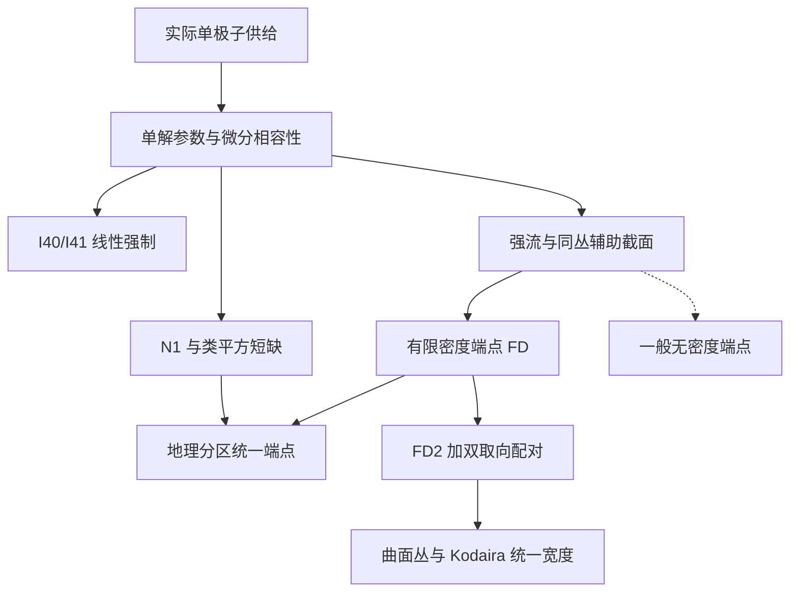
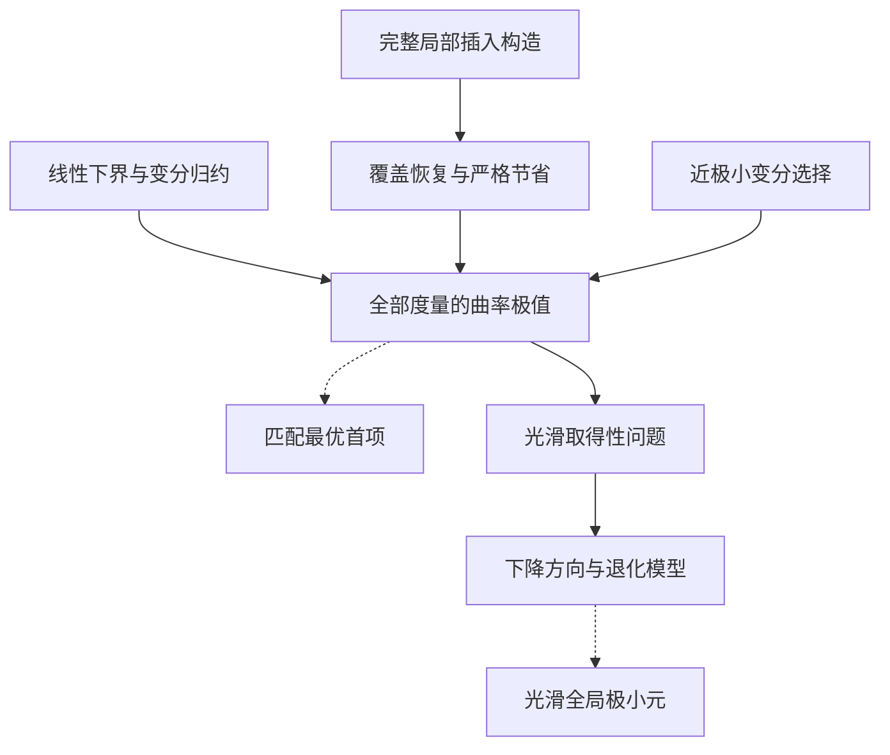
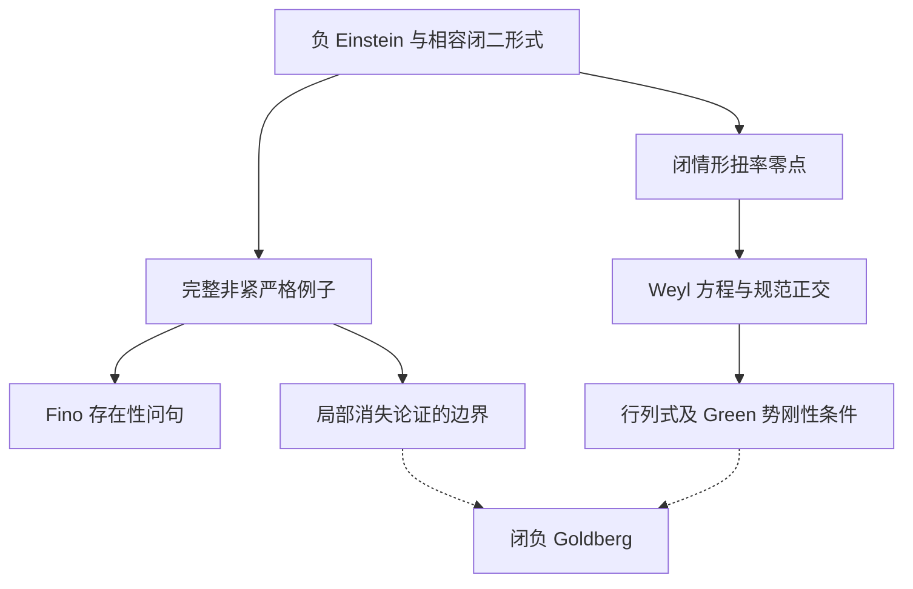

# 研究图谱与接续入口

研究围绕四维曲率方程的存在、逼近和变分极值展开。下图实线表示原稿已有明确依赖；虚线表示仍需新证明的连接。

N1 与 I40/I41 是互补输出；有限密度端点使用额外的端点分析。地理分区只对明确满足地理关系的族统一，不把所有有限密度常数取成同一个数。Kodaira 分支只调用固定 (B=2)，不等待一般无密度 O10。

详见 [间隙与端点](GAPS_AND_ENDPOINTS.md)。

严格上界、临界性、近稳定性、紧性和取得性是不同命题。标准费用已经被真实构造严格改善的范围，不再将系数 (4) 当作预定答案。Ricci-flat ALE 泡与塌缩颈部要求不同分析。

详见 [曲率变分](CURVATURE_VARIATION.md)。

最后一张图没有从“零点存在”直接连到“可积”。原稿已将剩余问题定位到零点处的全局 Green 势符号；局部高阶消失、谱重根相交和有限阶 jet 相容均不足以替代该连接。

详见 [几乎 Kähler–Einstein 几何](GOLDBERG.md)。

## 已发生的主要状态更新

| 较早判断或目标 | 后续状态 | 直接入口 |
|---|---|---|
| 原积分 gap 与新参数结果并列 | (\beta=8) 已严格回接为 N1，并有类平方短缺版 | `03_N1_Complete_Inheritance.md` |
| O10 仅覆盖固定数值阈值 | 所有固定有限密度；另有地理分区统一 | `O10_All_Finite_Density.md`；`Line1_Uniform_Endpoint_and_Residual_Tower_Recovery.md` |
| 标准恢复首项可能为 4 | 相应族已获严格次四构造 | `O11_Arbitrary_Collar_Logarithmic_Construction.md` |
| Kodaira 仅有逐对象严格不等式的比较 | FD2 前置下建立整个曲面丛范畴的统一宽度 | `Line1_Two_Orientation_Global_Gap.md` |
| 双取向仅用于曲面丛 | 允许一侧凸包与配对短缺 | `Pair_Gap_and_Pinched_Example.tex` |
| 低于标准单核费用可能足以紧 | 真实 Ricci-flat 核心退化反例要求重新区分子水平紧性与极小序列 | `Q3_Global_Attainment.tex` |
| Goldberg 只作形式局部计算 | 完整非紧例子、闭零点结构与精确 Green 势关系 | `Q4_Complete_Example_and_Fino_Question.tex`；`Goldberg_Two_Conversations_Merged_20261015.tex` |

历史证明和后续修订同时保留，见 [研究沿革](RESEARCH_HISTORY.md)。
