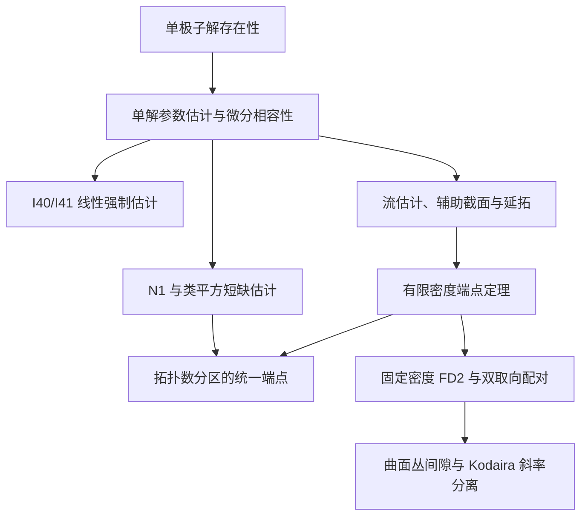

# 研究结构与定理关系

共同问题是：光滑四维流形的拓扑与相容几何结构如何限制 Einstein 度量的存在、逼近和曲率极值？积分间隙、极值构造与几乎 Kähler 刚性分别研究这一问题的不同方面。以下依赖关系均在相应定理的假设下成立；符号、常数及原始证明见各专题。

## 积分间隙与参数端点

N1 由有限参数估计在 $\beta=8$ 处与 Chern–Weil 恒等式结合得到；I40/I41 控制标量曲率超额与无迹 Ricci、Weyl 和场方程缺陷之间的关系。有限密度端点进一步使用辅助截面的微分方程及第五张量幂线丛的整体约束。

各分支的量词如下：

| 分支 | 统一范围 | 常数依赖 |
|---|---|---|
| 有限密度端点 | $\chi(M)/A\le B<\infty$ | $c(B)>0$ |
| 拓扑数分区 | $Q=A-T\ge0$、$\chi(M)\le CA+Q$，并满足相应解存在性条件 | 整族常数依赖固定的 $C$ |
| 双取向与 Kodaira 应用 | 曲面丛上的两取向实际类及交叉配对 | 使用固定 $B=2$ 的 FD2 |
| 一般端点问题 | 原允许范畴，不限制 $\chi/A$ 或另加上述拓扑关系 | 是否存在绝对统一正下界，仍待确定 |

这里 $T=2\chi+3\tau$，$A>0$ 是自对偶投影平方的统一下界。各分支的完整陈述见[积分间隙与端点](GAPS_AND_ENDPOINTS.md)。

## 曲率极值、构造与取得性

令 $P_*(M)=\inf_g\int_M|\operatorname{Ric}^{\circ}_g|^2\,dV_g$，下确界遍历全部光滑度量。下界分析和恢复构造共同约束该值；极小值是否由光滑度量取得则需要研究极小序列的紧性与退化。

| 研究部分 | 已有数学联系 | 尚待确定的结论 |
|---|---|---|
| 线性强制与全曲率归约 | 将平衡族的归一化缺陷与 $P_*$ 的一阶渐近相联系 | 全部竞争度量的最优首项 |
| 近极小序列选择 | 在临界测试范数下获得 $o(Q)$ 级近驻点与近稳定估计 | 能否由实际场与拓扑信息得到锐利下界 |
| 局部插入与覆盖恢复 | 背景曲率相互作用给出严格低于标准手术能量的闭流形度量 | 与严格上界匹配的下界及极值几何 |
| 共形 Kähler 比较 | 将严格低能量竞争者与整个所列共形 Kähler 类分离 | 一般非 Kähler 竞争者的结构 |
| AE/ALE 与极小序列 | 相对特征数公式、边界修正及 Anderson 的极限结构 | 手术类在极限中的分布、能量集中和塌缩 |
| 光滑取得性 | Horikawa 单吹起提供具有正下界和严格上界的固定对象 | 非 Bach-flat 光滑全局极小元 |

$Q$ 是原平衡族的手术参数，$Q=Ah$。在已获得严格次四构造的族上，标准首项 $4$ 已被改善；实际最优值仍未确定。详见[曲率变分](CURVATURE_VARIATION.md)。

点态逼近分支由固定轨形解消和固定曲面丛构造出发，通过周期、慢模态及修正方程研究精确 Einstein 实现。它与积分间隙之间的联系由各自的归一化、体积与几何控制条件决定，见[点态构造与精确实现](CONSTRUCTIONS_AND_REALIZATION.md)。

## 几乎 Kähler–Einstein 几何

设 $\operatorname{Ric}=-ag$、$a>0$，并有相容闭二形式 $\Omega$、$|\Omega|^2=2$。研究分为完备非紧存在性和闭流形刚性。

| 研究部分 | 结论及联系 |
|---|---|
| 完备非紧构造 | $\mathbb R^4$ 上显式的严格几乎 Kähler–Einstein 度量，对应 Fino 所述非不变存在性问题 |
| 扭率零集 | 闭 Einstein 条件下零点存在；导数秩、局部指数与零曲线受曲率方程限制 |
| 典范联络与调和形式 | 正交关系、积分因子及调和乘积方程给出条件性可积结论 |
| Weyl 方程与 Green 势 | 在一个扭率零点满足所列 Green 势非正条件时，得到 Kähler 刚性 |
| 闭负 Goldberg | 需证明一般闭候选满足足够的整体刚性条件，或构造闭的严格几乎 Kähler–Einstein 例子 |

完备非紧例子说明负 Einstein 条件与严格非可积性可以共存；闭情形的可积性涉及紧致流形上的整体条件。具体方程及条件定理见[几乎 Kähler–Einstein 几何](GOLDBERG.md)。

## 研究沿革与相邻课题

主要定理的先后关系、构造适用范围的扩大及已订正的结论见[研究沿革](RESEARCH_HISTORY.md)；共同方法和经典来源见[方法与文献](METHODS_AND_LITERATURE.md)。

早期材料另收录四维 Pontryagin 形式的局部实现与障碍，以及 K3／Kummer 修正的显式化方案，分别对应原任务中的 Yau19、Yau23。现存材料记录其研究计划与方法，见 [9月9日交接稿](../archive/originals/2026-09-09/yau_problem_set_handoff.md)及[9月15日交接稿](../archive/originals/2026-09-15/yau_problem_set_ai_research_handoff.md)。
