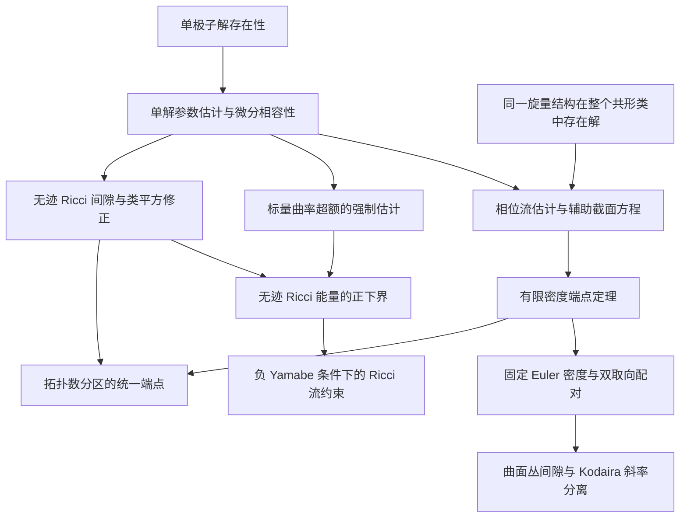

# 研究主题与定理关系

Shuxing Yang, Junyao Wu, Rui Zhao, Hongsheng Chen, Yihao Yang  
Qiushi Engine Team, Zhejiang University · [作者与通讯信息](../AUTHORS.md)

研究对象是光滑四维流形上的 Einstein 方程、曲率泛函及相容辛结构。积分间隙描述 Einstein 方程的积分逼近障碍，变分与构造确定曲率下确界，几乎 Kähler 刚性研究 Einstein 条件下相容概复结构的可积性。各部分的定义、假设和证明见相应专题。

## 积分间隙与参数端点

无迹 Ricci 间隙由有限参数估计在 $`\beta=8`$ 处与 Chern–Weil 恒等式结合得到。标量曲率超额的强制估计控制标量曲率超额与无迹 Ricci 能量、Weyl 曲率及场方程缺陷之间的关系。二者均以负 Yamabe 代表上的一个单极子解为条件。有限密度端点和固定拓扑比例端点还要求同一旋量结构在整个共形类中存在解，其证明使用辅助截面的微分方程及第五张量幂线丛的整体约束。

端点估计的适用范围如下：

| 分支 | 统一范围 | 常数依赖 |
|---|---|---|
| 有限密度端点 | $`\chi(M)/A\le B<\infty`$ | $`c(B)>0`$ |
| 固定拓扑比例端点 | $`T_+/A\le\theta<3/4`$，同一旋量结构在整个共形类中存在解 | 依赖 $`\theta`$，不使用 Euler 密度上界 |
| 拓扑数分区 | $`Q=A-T\ge0`$、$`\chi(M)\le CA+Q`$，并满足相应解存在性条件 | 整族常数依赖固定的 $`C`$ |
| 双取向与 Kodaira 应用 | 曲面丛上两个取向的单极子类及其交叉配对 | 使用 $`B=2`$ 的有限密度端点定理 |
| 一般端点问题 | 满足单极子解与类平方假设，不限制 $`\chi/A`$，也不加上述拓扑关系 | 是否存在绝对统一正下界，仍待确定 |

这里 $`T=2\chi+3\tau`$，$`A>0`$ 是自对偶投影平方的统一下界。各分支的完整陈述见[积分间隙与端点](GAPS_AND_ENDPOINTS.md)。

## 曲率极值、构造与取得性

令 $`P_*(M)=\inf_g\int_M|\operatorname{Ric}^{\circ}_g|^2\,dV_g`$，下确界遍历全部光滑度量。下界分析和恢复构造共同约束该值；极小值是否由光滑度量取得则需要研究极小序列的紧性与退化。

| 研究部分 | 已有数学联系 | 尚待确定的结论 |
|---|---|---|
| 线性强制与全曲率归约 | 将平衡族的归一化缺陷与 $`P_*`$ 的一阶渐近相联系，并给 Weyl–Yamabe 精确可行域 | 一般平衡族的最优首项 |
| 近极小序列选择 | 在临界测试范数下获得 $`o(Q)`$ 级近驻点与近稳定估计 | 能否由单极子方程与拓扑约束得到锐利下界 |
| 局部插入与覆盖恢复 | 背景曲率相互作用给出严格低于标准手术能量的闭流形度量 | 与严格上界匹配的下界及极值几何 |
| 共形 Kähler 比较 | 将严格低能量竞争者与整个所列共形 Kähler 类分离 | 一般非 Kähler 竞争者的结构 |
| cscK 局部变分 | 缺陷差驻定、核上的上同调障碍及曲面乘积的显式鞍点 | 全部变分方向上的局部或全局最小性 |
| AE/ALE 与极小序列 | 相对特征数公式、边界修正及 Anderson 的极限结构 | 手术类在极限中的分布、能量集中和塌缩 |
| 成对 $`A_1`$ 奇点与根格嵌入 | 指定轨形范畴的精确极值及非取得性；指定解消中的混合曲率转移与 $`D`$ 型格约束 | 一般端群、局部周期与任意竞争序列的对应 |
| Wahl 收缩 | 单极子解、类平方及自对偶曲率估计在收缩中的传递；局部群表示强迫零点 | 从逐度量严格性得到具有正确尺度的统一改进量 |
| 光滑取得性 | Horikawa 单吹起提供具有正下界和严格上界的固定对象 | 非 Bach-flat 光滑全局极小元 |

$`Q`$ 是原平衡族的手术参数，$`Q=Ah`$。在相应构造适用的流形族上，归一化缺陷的渐近上界已严格低于标准首项 $`4`$；实际最优值仍未确定。详见[曲率变分](CURVATURE_VARIATION.md)。

## 从近似 Einstein 度量到精确解

在固定轨形的解消与固定曲面丛上，点态逼近和精确解的构造具有以下关系：

| 几何条件 | 分析方法 | 结论 |
|---|---|---|
| 循环覆盖双曲乘积邻域 | 保留完整 Teichmüller 零空间，其正交补上的逆估计含 $`m^2`$ 因子 | $`cm^{-2}`$ 邻域内的非线性校正及局部精确解的描述 |
| 正强制性、受控调和坐标及球体积增长 $`H^2<8\lambda`$ | 指数权估计与体积增长比较给出局部一致的逆估计 | 不要求直径及总积分残差上界的精确校正 |
| 厚部曲面丛上的小闭路累计变形 | Teichmüller 位移与有限稳定子 | 同一光滑丛上的精确乘积商 |
| 近饱和轨形极限及完整填充控制 | 谐和零点尺度、标记 Milnor 填充及全局复平滑 | 所列范畴中的负 Kähler–Einstein 实现 |

上述存在性定理的几何条件见[点态构造与精确实现](CONSTRUCTIONS_AND_REALIZATION.md)及[Wahl 奇点上的单极子场与形式延拓](../research/notes/Wahl_Fields_and_Formal_Completion.md)。

## 几乎 Kähler–Einstein 几何

设 $`\operatorname{Ric}=-ag`$、$`a>0`$，并有相容闭二形式 $`\Omega`$、$`|\Omega|^2=2`$。研究分为完备非紧存在性和闭流形刚性。

| 研究部分 | 结论及联系 |
|---|---|
| 相容辛形式与局部插入 | 低曲率能量构造可同时具有全局非零闭自对偶形式；其几乎 Kähler 共形代表的标量能量可能发散 |
| 完备非紧构造 | $`\mathbb R^4`$ 上显式的严格几乎 Kähler–Einstein 度量，对应 Fino 所述非不变存在性问题 |
| 扭率零集与局部形式 | 闭 Einstein 条件下零点存在；导数秩、高阶首项及零曲线受曲率方程限制；Darboux 表示明确线性相容条件 |
| 典范曲线与扭率 | 典范联络的闭半正形式给出曲线锥配对与异常曲线上的扭率积分限制 |
| 典范联络与调和形式 | 正交关系、积分因子及调和乘积方程给出条件性可积结论 |
| 固定负 KE 度量与耦合形变 | 长度缺陷的二次障碍及相容形式的局部孤立性；指定颈部条件下的调和迹匹配 |
| Weyl 方程与 Green 势 | 在一个扭率零点满足所列 Green 势非正条件时，得到 Kähler 刚性 |
| Einstein 作用与轨形极限 | 连通分支上的作用量常值；所述非塌缩退化中自对偶 Weyl 和扭率不集中 |
| 闭负 Goldberg | 需证明一般闭候选满足足够的整体刚性条件，或构造闭的严格几乎 Kähler–Einstein 例子 |

完备非紧例子说明负 Einstein 条件与严格非可积性可以共存；闭情形的可积性涉及紧致流形上的整体条件。具体方程及条件定理见[几乎 Kähler–Einstein 几何](GOLDBERG.md)。

## 经典问题与现有结论

| 问题 | 本文集中的结论与开放部分 |
|---|---|
| Kodaira 斜率是否统一远离 $`3`$ | 有限密度端点定理与双取向配对给出 Kodaira 纤维化的统一斜率分离；最佳常数未确定 |
| Fino 的非不变、非 Ricci-flat 严格几乎 Kähler–Einstein 存在问题 | $`\mathbb R^4`$ 上完备、非齐性的显式例子 |
| 非极小一般型曲面的 Einstein 存在性 | 无迹 Ricci 间隙扩大 Einstein 非存在性的已知区间；轨形转移和填充约束限制若干退化路线；一般问题未决 |
| 最优全曲率 | 严格上界、特定轨形范畴的精确值及解消转移；一般吹起范畴的全度量最优值未决 |
| 非 Bach-flat 光滑全局最优度量 | 已有能量窗口、下降方向和退化条件；光滑全局取得性未决 |
| 闭四维负 Goldberg | 条件刚性、模空间和退化限制；一般闭结论未决 |

Kodaira 斜率结论见[双取向应用](GAPS_AND_ENDPOINTS.md)，完备非齐性构造见[几乎 Kähler–Einstein 几何](GOLDBERG.md)。Einstein 存在性、曲率下确界及光滑取得性见[曲率变分](CURVATURE_VARIATION.md)。

## 方法与相关问题

证明之间的联系及构造方法的发展见[数学发展与证明关系](RESEARCH_HISTORY.md)；分析工具和经典来源见[方法与文献](METHODS_AND_LITERATURE.md)。

资料中另有四维 Pontryagin 形式的局部实现与障碍，以及 K3／Kummer 构造中校正项的显式化方案。问题陈述与已有方法分别见[曲率形式与 Einstein 几何研究纲要](../archive/originals/2026-09-09/yau_problem_set_handoff.md)及[相关问题的补充说明](../archive/originals/2026-09-15/yau_problem_set_ai_research_handoff.md)。
