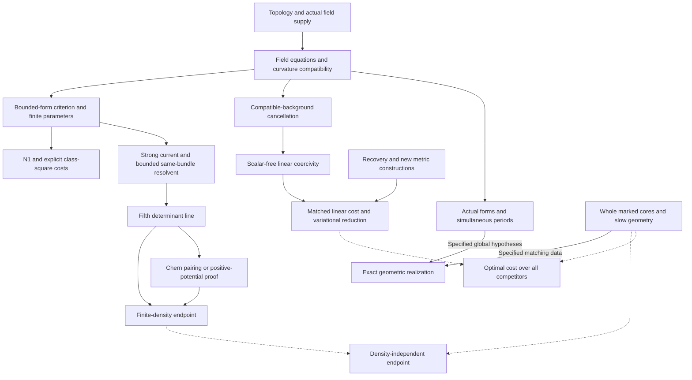

# Curvature realizability: research map

The common question concerns **exact solutions, approximation, optimal
cost, and limiting geometry under topology and actual-field constraints**.
The principal developed setting is four-dimensional Einstein geometry.
The earlier construction and unrestricted-existence programs remain part
of the library, including results not used in the integral-obstruction
paper.

## Knowledge tree

```text
Curvature-equation realizability
├── Actual geometric information
│   ├── Bounded self-dual forms and their Hodge source
│   ├── Ordinary / special monopoles, polarization and chambers
│   └── Bauer–Furuta supply and actual Pin-minus double-cover lifts
├── Differential compatibility and quantitative cost
│   ├── Smooth curvature models, Hessian estimates, weak Bianchi testing
│   ├── Finite parameters and a single Yamabe monopole
│   ├── N1: trace-free Ricci separation and both square costs
│   └── I40/I41: compatible-background cancellation and linear coercivity
├── Simultaneous structures on one metric
│   ├── Actual forms and harmonic Chern alignment
│   ├── Period matrices, positive inertia, and sign correlations
│   └── Product calibration, variable amplitudes, allowed Weyl structures
├── Extremal geometry and constructions
│   ├── Recovery metrics, linear scale, exact handle-only optimum
│   ├── Full-curvature reduction and critical variational selection
│   ├── Moving centers, caps, relative cells, and coupled fillings
│   └── Transverse variations, curvature flow, and matter consequences
├── Degeneration and transfer of actual information
│   ├── Strong currents, same-bundle resolvents, fifth determinant line
│   ├── Every fixed finite-density endpoint and quantitative density loss
│   ├── Signed flux, torsion, holonomy, and whole marked cores
│   └── Density-independent endpoint and general near-minimizer structure
├── Exact realization
│   ├── Topological exclusion of bubbles and compactness
│   ├── Bilateral / Chern-boundary / finite-cover realization
│   ├── Local full-tensor repair, kernels, monodromy and slow fields
│   └── Orbifold limits, whole fillings, and global smoothing
└── Fixed manifolds and all possible outputs
    ├── Dehn-twist bundles and integer-shear closed constructions
    ├── A1 / logarithmic-Weyl construction program
    └── Global topology, positive branches and independent existence tests
```

## Proof connections



Each solid connection refers to a proof with its stated hypotheses, not
an unconditional assertion between the box labels. Dotted connections
are possible strengthenings. The two fifth-line endings are alternatives.
A direct proof can bypass a decomposition or a variational limit theory.

## Reading routes

Unless an original manuscript is explicitly named, the labels below are searchable in
[Curvature_Realizability.tex](../research/Curvature_Realizability.tex).
Original filenames are searchable in [source-index.tsv](source-index.tsv).
The [source library](source-library.md) locates the complete earlier
versions, web additions, corrections, and supplementary arguments.

### 1. Actual suppliers and analytical interfaces

Start with [field interfaces](../research/paper/sections/field_interfaces_and_curvature_interactions.tex),
then `sec:bounded-forms` and `sec:intrinsic-calibration`. The
supplier-independent criterion needs an actual bounded self-dual form
and a Hodge-source budget. The finer spinor theorem additionally uses
connection curvature and the determinant-square identity.

Suppliers: `sec:cover-obstructions`, `sec:twisted-supply`,
`sec:bf-geography`; originals `lebrun_stability_closure.md`,
`round13_chamber.md`, `round14_twisted_rigidity.md`,
`line1_bauer_furuta_geography.md`. This preserves ordinary, special,
polarized, chamber-dependent, stable-cohomotopy, and twisted inputs
with their different quantifiers.

### 2. Parameters, N1 and linear coercivity

Read [single parameter statement](../research/paper/sections/single_parameter_statement.tex),
[trace-free gap](../research/paper/sections/tracefree_gap.tex),
[linear coercivity](../research/paper/sections/linear_coercivity.tex), and
[single-solution coercivity](../research/paper/sections/single_solution_coercivity.tex).
Useful labels: `thm:single-parameter`, `def:trf-input`, `thm:trf-gap`,
`cor:trf-nu`, `cor:trf-y`, `thm:lc-scalar-free`, `thm:ssc-coercivity`.

The original weighted method and its development are retained in
`line1_integral_rigidity_paper.md`, `line1_functional_pencil.md`,
`20260927_mixed_current_and_signed_cores.md`,
`20260927_conformal_separation_and_zero_end.md`, and
`20260927_constant_weight_and_global_fit.md`.

### 3. Multiple actual structures

Search `sec:actual-forms`, `sec:scalar-band`, `sec:period-inertia`,
`sec:periods`, `sec:positive-planes`, `sec:joint-matrix`,
`sec:product-calibration`, `sec:variable-calibration`,
`sec:signed-weyl`, and `sec:spectral-einstein`.

Originals include `line1_composed_application.md`,
`line1_period_inertia.md`, `round18_periods.md`, `round20_rigidity.md`,
`20260926_boundary_compatibility.md`, `line1_variable_calibration.md`,
and `line1_signed_harmonic_weyl.md`. Relative signs, negative Hodge
components and low spectral modes remain explicit. The joint matrix
criterion has not yet supplied a new actual separating family.

### 4. Extremal cost, recovery and variation

Start with [variational geometry](../research/paper/sections/variational_geometry.tex)
and [global variational selection](../research/paper/sections/variational_selection_and_global_cost.tex).
The current all-competitor reduction is `thm:vg-first-order-reduction`;
the handle-only exact value is `thm:vg-handle-sharp`.

`sec:surgery-stability`, `sec:moving-centers`, `sec:caps`,
`sec:relative-cells`, `sec:coupled-filling` and `sec:signed-selection`
preserve the refined local and global constructions. Corresponding
continuations run from `20260927_endpoint_covariance_and_surgery_limits.md`
through the 28 September caps, cells and characteristic-selection files.
Coefficient four in these stated neighborhoods does not already give
the unrestricted balanced optimum.

The [4 October mathematical supplement](../research/supplements/20261004_classical_and_quantitative_gaps.tex)
records the later complete-cell construction with a balanced first-order
upper bound strictly below four on suitable CH cover towers. The local
stability results retain their stated scope; the unrestricted optimum
is not reduced to a prescribed family of cells.

`sec:conformal-flow` and
[quadratic/matter applications](../research/paper/sections/quadratic_and_matter.tex)
are downstream consequences with their own equations. Flow lifetime
does not decide all Einstein outputs.

### 5. Endpoint, torsion and marked cores

Start with [finite-density endpoint](../research/paper/sections/finite_density_endpoint.tex)
and [primitive rates](../research/paper/sections/web_primitive_rate.tex).
The strong-current, direct-resolvent and first-prolongation proofs are
`sec:web-strong-current`, `sec:web-direct-resolvent`,
`sec:web-first-prolongation`; the alternative ending is
`sec:web-positive-potential`. Web files A--F and `other_web/` retain
both derivations, double weighting, actual mass transfer, inverse moments,
and the full radial operator.

Whole-core geometry is in `sec:whole-core`, `sec:marked-charge`,
`sec:actual-core-fit`, `sec:phase-curvature` and `sec:quartic-flux`.
Originals include `20260927_full_core_cost_and_extremal_metrics.md`
and `20260927_marked_charge_and_first_order_flux.md`. The high-index
zero-determinant-charge model and its extension costs are kept alongside
the positive-cost formulas; neither replaces closed global supply.

### 6. Compactness and exact realization

Use `sec:ale-boundary`, `sec:bilateral`, `sec:chern-boundary`,
`sec:virtual-realization`, `sec:local-repair`,
`sec:higher-local-repair`, `sec:thin-monodromy`, `sec:cyclic-kernel`,
`sec:slow-moduli`, `sec:moduli-gauge`, `sec:orbifold`,
`sec:milnor-matching`, and `sec:harmonic-zeros`.

These paths are separate sufficient theorems. The Chern-boundary
identity can force saturation from numerical input; bilateral saturation
controls both Weyl halves; topological exclusions can prevent bubbling;
covering data can supply structure on the base. The specified cyclic
cover repair already handles the full integrable kernel, with its
`m^2` inverse loss and shrinking neighborhood. The fixed-amplitude
slow-family results have a different output class. Complete filling
and smoothing require their actual global matching data.

### 7. Closed constructions and unrestricted exact outputs

Read [fixed bundle geometry](../research/paper/sections/fixed_bundle_geometry.tex),
`sec:closed-shear`, `sec:shear-topology`, `sec:virtual-nonkahler`,
`sec:shear-global`, `sec:shear-symmetry`, and `sec:slow-construction`.
The fixed bundle has volume `16 pi^2 (p-1)(q-1)` for the specified
fiber/base genera, not universally `16 pi^2`.

For the independent A1/logarithmic-Weyl development, find
`20260916_construction.tex` (`thm:A1`, `sec:scalechoice`) and
`20260912.tex` (`FND:A1construction`). Early unrestricted-output
analysis and positive/algebraic constructions remain in
`20260916_global.tex`, including `sec:bundle-values`,
`sec:bcgp-global-object`, and `sec:campedelli-global-object`.
These are preserved as their own programs, not relabeled as consequences
of the integral gap.

## How the argument developed

The source library retains the transition from early pointwise pinching,
local construction and global topology, through weighted integral
calibration and parameter families, to actual period geometry and
conditional realization. Later compatible-background cancellation
removed the background-volume loss and produced linear coercivity;
conformal transfer and a constant-weight actual solution sharpened the
input. N1 reconnected the original gap at the aligned parameter. The
web increment added strong currents, the fifth-line finite-density
endpoint, and concentration-scale variational selection. The latest
overview reconnects these developments to the broader realizability
question and to spectral and curvature-interaction methods.

This progression is recorded in `EVOLUTION.md`,
`CLAIMS_AND_CORRECTIONS.md`, the original continuation texts, and the
web source maps. The present [results and questions](results-and-questions.md)
give the current mathematical starting point.
