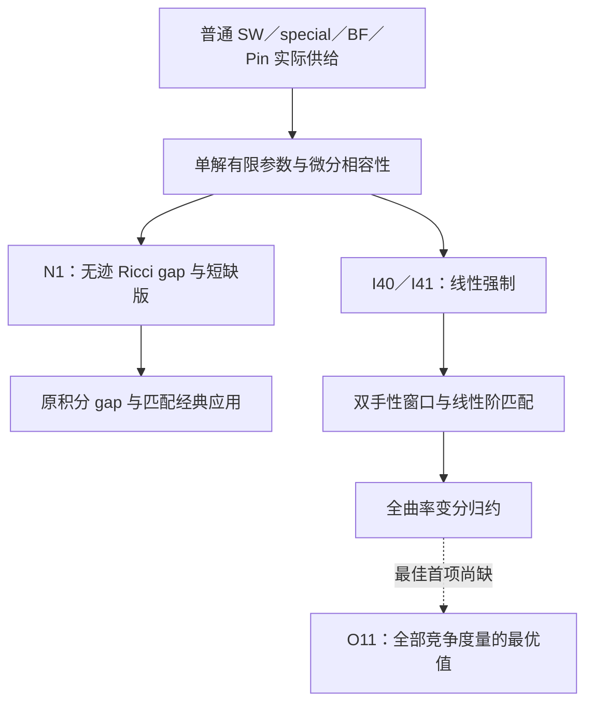
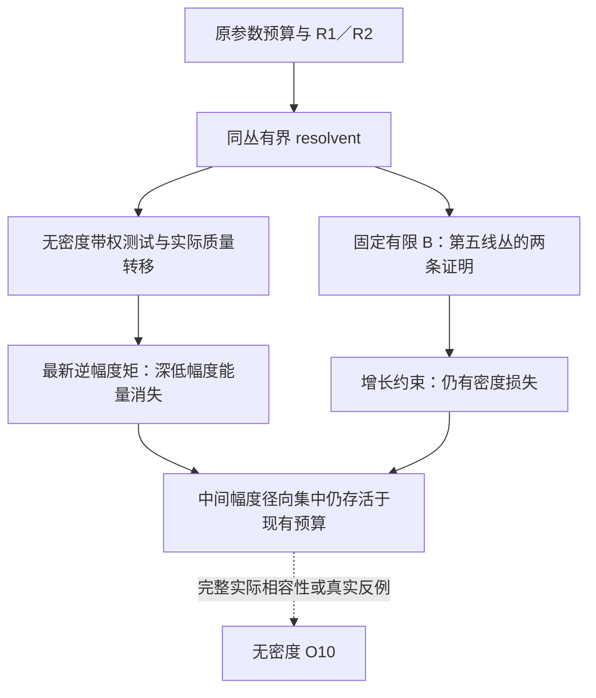
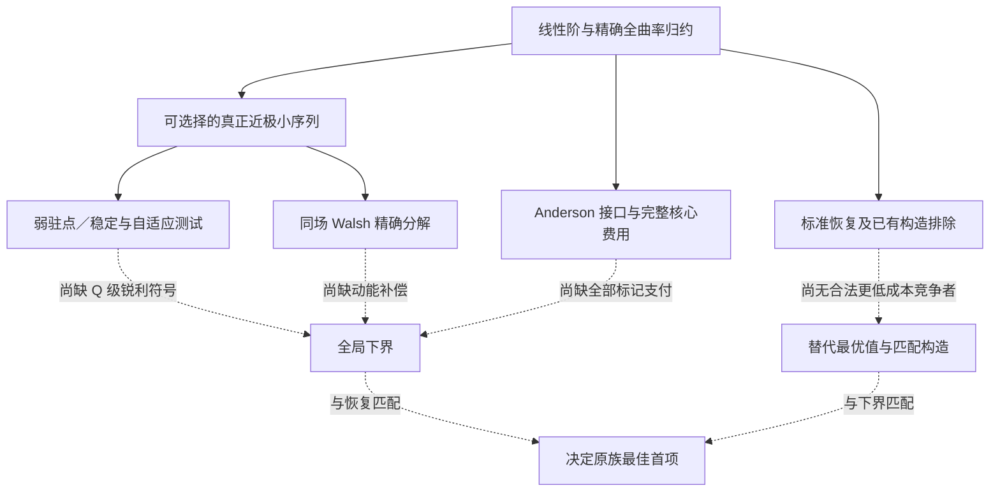

# 第一主线的知识图谱与证明接口

实线表示来源稿中已有的推导或使用关系；虚线表示仍缺的数学连接。各节点依原命题的假设使用。图示不是对全部前置分析的新认证。完整关键节点与来源见 `02_Claim_Ledger.json`；早期全量图谱位于 `sources/outputs/Line1_Atlas_20260928/01_Knowledge_Graph.json`。

更早研究的阶段、来源及续接关系另见 [06_Earlier_Stage_Register.md](06_Earlier_Stage_Register.md)。阶段先后不强行改画成必需证明依赖；原Atlas全量图谱保留。

## 共同主干

经典非消失理论负责真实输入，共同分析负责新增强制。N1 与 I40/I41 的结论不同，均须保留。旧积分 gap 已由 N1 严格回接，不再只是平行陈列。

## O10：有限密度以后

有限密度两条证明的具体前置不同，不能因终点相同便强行串成一条必经链。无密度工具未给出 \(dm\to0\) 或第五线丛截面的全部质量保留。

## O11：已有工具与真正缺口

O10 的 (o(V)) 信息不自动具有 O11 的 (o(Q)) 精度；两项没有“先解 O10 就自动解 O11”的已证箭头。Anderson 路线是可用选择，不是 O11 强制采用的方法。

## 不可误画的五条箭头

1. \(\forall B<\infty\ \exists c(B)>0\) 不推出 \(\exists c>0\ \forall B\)。
2. 深低幅度能量消失不推出所有径向能量消失。
3. 近驻点／近稳定不推出全局最佳系数。
4. 一般 ALE 二周期不推出普通 AE 的 \(8\pi^2\) 无迹 Ricci 费用。
5. 两个加强目标未解不推出已有 N1／I40／I41 证明失效。
