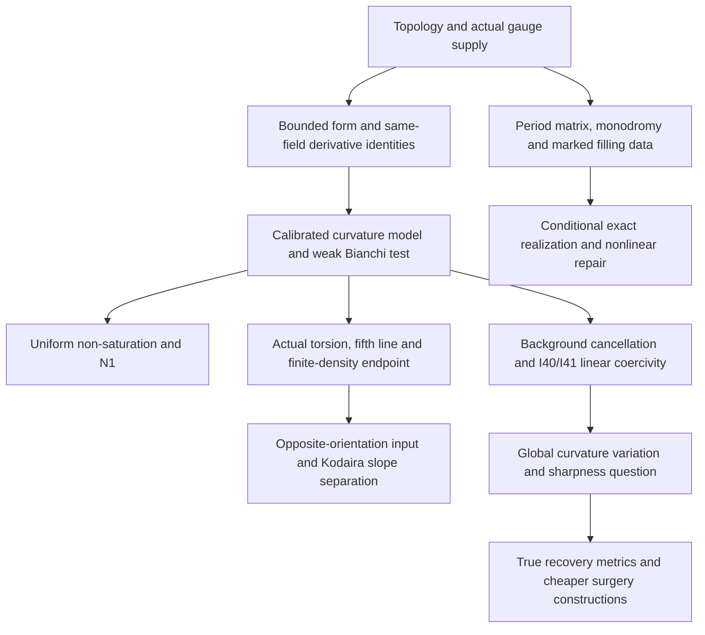

# Codex research: proofs, constructions and their development

This part preserves the server's mathematical work from the three Yau26 research lines to the Einstein-gap programme. It connects the original proof files, the later manuscript, mathematical computations and dated research correspondence. The two subsequent autonomous Sessions have their own continuations: [S1003A01](../sessions/S1003A01/README.md) and [S1003A02](../sessions/S1003A02/README.md).

The common question is how closely a smooth manifold can satisfy an Einstein equation, and what topology and actual geometric fields force that approximation to cost. The original programme also asks when approximate solutions produce an exact metric on the **same smooth manifold**. Integral obstruction, a construction of approximate metrics, and exact existence therefore remain distinct conclusions.

## Reading the mathematical argument

| Mathematical question | Proof and development |
| --- | --- |
| Where do the current analytic estimates come from? | [Continuous English manuscript](project/paper/Integral_Einstein_Rigidity.tex), [source-to-manuscript map](project/paper/RESEARCH_TO_MANUSCRIPT.md), and the [October 1 standalone version](project/handoff/20261001_Line1_Integrated_Manuscript.tex). |
| How did the original three lines become connected? | [Three-line mathematical map](project/navigation/RESEARCH_MAP.md), [causal history](project/navigation/EVOLUTION.md), and [Rounds 1–12 synthesis](project/mathematics/current/SYNTHESIS.md). |
| Which old arguments changed their scope or failed? | [Corrections with proof references](project/navigation/CLAIMS_AND_CORRECTIONS.md). These include the failed fixed-topology AH completion, cscK equality examples, moving-center gauge failure and the limits of local surgery costs. |
| What was added when the two autonomous Sessions began? | [October 8 four-problem synthesis](project/handoff/20261008_Einstein_Gaps_Four_Problems/01_Research_Synthesis.tex), [source companion](project/handoff/20261008_Einstein_Gaps_Four_Problems/02_Mathematical_Source_Companion.tex), and [subsequent mathematics](project/handoff/20261008_Einstein_Gaps_Four_Problems/03_Subsequent_Mathematical_Developments.tex). |
| How were hypotheses, routes and conclusions reconsidered? | Dated mathematical correspondence for [September](history/2026-09_research_correspondence.md) and [October](history/2026-10_research_correspondence.md); [research commit chronology](history/research_commits.tsv). |
| What is supported for the two external public questions? | [Kodaira and Fino: proof examination and literature comparison](project/continuation/20261031_Kodaira_Fino_Literature_and_Proof_Status.md). |

The correspondence contains 661 distinct final research responses, with entries from the main conversation and 153 subsidiary conversations. The extraction covered 157 conversations in total; identical early responses were retained once. It preserves mathematical reasoning that did not always become a separate file, including objections and later corrections. Its statements are dated research records; the topic documents and their linked latest proofs determine the current scope.

## The change in proof mechanism

Initially, an approximate Einstein input was to be converted into controlled local geometry before applying rigidity. Collapse, moving topology and the absence of uniform curvature or Sobolev bounds obstructed that route. The integral argument instead works on the original metric with an actual gauge field.

An actual monopole supplies a bounded self-dual form. Its equation controls the covariant Hessian, and a smooth polynomial curvature model can be inserted into a weak Bianchi identity. The model is compared with the derivatives of the **same field**, rather than with an independently chosen almost-equality profile. This adds differential information to the characteristic-number budgets.

The [bounded-form theorem](project/mathematics/current/round21_analytic.md) separates that analytic mechanism from the particular supplier of the field. The [actual-form supply theorem](project/mathematics/current/line1_composed_application.md) then explains how the gauge equation supplies its hypotheses. Ordinary monopoles, polarized inputs, appropriate Bauer–Furuta sums and genuine twisted monopoles enter through their respective existence results; the analytic argument is shared.

The arrows have different hypotheses. In particular, the finite-density theorem is not an unrestricted endpoint theorem, and the realization branches require the stated global fibration, diameter, marking or smoothing information.

## Main mathematical stages

### 1. Three sources of geometry: obstruction, approximation and unrestricted output

The early work developed integral monopole rigidity, marked orbifold resolutions and slow interpolation on fixed surface-bundle topology. Its global branch examined all possible Einstein outputs on the same smooth manifold, including fundamental-group restrictions, non-Kähler finite covers, free-circle conformal boundaries and connectors.

The [Round 4 intrinsic proof](project/mathematics/current/round4_rigidity.md) and its [all-sign version](project/mathematics/current/round4_all_sign_gap.md) removed the need for a local unfolding theorem in the specified monopole application. The [polarized extension](project/mathematics/current/round13_chamber.md) retained metricwise class selection and the same class across the required conformal weights; [twisted supply](project/mathematics/current/round14_twisted_rigidity.md) used actual equations on a double cover.

The construction and realization material remains useful independently of that gap. It includes [fixed closed shear constructions](project/mathematics/current/round11_closed_gluing.md), [full product and Teichmüller modes](project/mathematics/current/round17_product_operator.md), [finite-monodromy nonlinear realization](project/mathematics/current/round18_twisted_operator.md), and [period-matrix constraints from multiple actual classes](project/mathematics/current/round18_periods.md).

### 2. Finite parameters, the correct linear scale and conformal reduction

The [parameter pencil](project/mathematics/current/line1_functional_pencil.md) distinguishes the cscK-compatible value \(\beta=2\) from the topological calibration \(\beta=8\). Its [compactification](project/mathematics/current/line1_compactified_pencil.md) retains the endpoint decay forced by realizable models. Independent opposite-chirality Chern–Weil information gives a second energy budget and [new actual BF families](project/mathematics/current/line1_bauer_furuta_geography.md).

The decisive later improvement is [I40](project/continuation/20260927_mixed_current_and_signed_cores.md). Keeping the compatible curvature model inside the exact Hessian identity eliminates the background-volume loss. The same-field weak test gives an inequality of the form
\[
K\le C\Theta+C\sqrt{\Theta K},
\]
so the derivative energy can be absorbed at the defect scale. [I41](project/continuation/20260927_conformal_separation_and_zero_end.md) removes the independent scalar-variance payment and controls the normalized trace-free Ricci defect
\[
\mathcal J(g)=\frac{4P(g)}{R(g)},\qquad
P(g)=\int|\operatorname{Ric}^{\circ}|^2,\quad
R(g)=P(g)+\frac14\int s^2.
\]
These estimates determine the linear order on the stated balanced family. The stronger same-solution [I51 parameter estimate](project/continuation/20260927_constant_weight_and_global_fit.md) also supplies the later N1 return to the original integral obstruction. The full manuscript retains the square-shortfall versions and the negative-class-square cost separately.

### 3. What the recovery geometry does and does not force

[Moving centers](project/continuation/20260928_marked_centers_and_harmonic_slices.md) show that a uniformly controlled fixed-base exact Bianchi slice can fail even for nearby genuine recovery metrics. [Matched caps](project/continuation/20260928_intrinsic_caps_and_stability.md) bypass that failed normalization and recover a coefficient-four theorem in shrinking neighborhoods with the required marked annuli.

The [relative-cell analysis](project/continuation/20260928_relative_cell_cost.md) and [coupled filling calculation](project/continuation/20260928_localization_and_coupled_filling.md) distinguish a complete ordinary AE filling from a cell inserted into curved background. A local or fixed-collar tariff is not automatically a lower bound for every competing closed metric. [Signed bulk selection](project/continuation/20260928_signed_characteristic_selection.md) records an actual obstruction to one proposed automatic selection rule.

This distinction became essential when the subsequent Sessions constructed closed competitors with an asymptotic coefficient strictly below four. The earlier neighborhood theorems retain their stated meaning; they never established the unrestricted optimum. The newer construction and its generalizations are indexed in [S1003A01](../sessions/S1003A01/README.md) and the repository's [construction chapter](../../../docs/CONSTRUCTIONS_AND_REALIZATION.md).

### 4. The endpoint gained topology carried by an actual section

The September endpoint calculations retained the actual cubic torsion, phase curvature, signed transition flux and low-amplitude concentration. Their [first prolongation](project/continuation/20260928_actual_torsion_prolongation.md) and [global flux identity](project/continuation/20260928_signed_quartic_flux.md) explain why some apparent positive terms cancel and why scalar amplitude estimates alone do not settle the endpoint.

The later finite-density proof, integrated in [the manuscript section](project/paper/sections/finite_density_endpoint.tex), adds a section of the fifth determinant line. Strong-current control, logarithmic resolvent selection and Chern pairing turn the remaining concentration into a contradiction at each fixed Euler density. This changes the admissible range of the theorem; it does not merely improve a growth exponent. The [web primitive-rate section](project/paper/sections/web_primitive_rate.tex) and [variational selection section](project/paper/sections/variational_selection_and_global_cost.tex) retain the other mathematical increments that accompanied it.

### 5. Exact realization required additional global information

The programme also developed positive existence statements. The [full-kernel cyclic repair](project/continuation/20260924_integrable_kernel_cyclic_repair.md) keeps the Teichmüller kernel and proves the \(m^2\) inverse loss together with a nonlinear repair radius in its specified family. [Nonlinear slow energy](project/continuation/20260924_nonlinear_slow_moduli.md) identifies a genuine moduli Dirichlet energy and preserves fixed-amplitude slow families.

[Cycle holonomy](project/continuation/20260924_cycle_holonomy_realization.md), the [thin-monodromy alternative](project/continuation/20260924_thin_monodromy_alternative.md), and [harmonic core matching](project/continuation/20260924_harmonic_contact_milnor_matching.md) supply different global connections to exact geometry. [Core-zero scale control](project/continuation/20260924_harmonic_zero_scale.md) quantifies one missing nonvanishing condition. These results preserve the exact smooth type and marking required by their statements; they are not a universal theorem that small integral error can always be repaired.

## Public questions and current mathematical status

The four later targets—Einstein metrics on nonminimal general-type surfaces, optimal total curvature, non-Bach-flat smooth global minimizers, and the closed negative Goldberg problem—arose from the same estimates and constructions. The October handoffs record progress on each without making their simultaneous resolution a premise of the established gap results.

Two separate external applications need their full mathematical scope:

- **Kodaira slopes.** The manuscript connects the finite-density theorem to two actual canonical classes and their same-metric Hodge pairing. For a negative Kähler–Einstein Kodaira surface with slope \(r\to3\), the opposite-orientation budget satisfies \(\chi/A_-=1/(4-r)\le1\). Thus one fixed density constant would rule out that sequence and give \(c_1^2/c_2\le3-\varepsilon\) for the whole class. The October 31 reading found no substantive error in the reviewed application, strong-current, resolvent and Chern-pairing chain. A fully independent reconstruction of all upstream spinor component identities remains unfinished; this record does not replace that missing reconstruction with a claim that it was done.
- **Fino's existence question.** The explicit construction extends smoothly to a complete nonhomogeneous structure on \(\mathbb R^4\), with \(\operatorname{Ric}=-3g\), \(W^-=0\), \(d\Omega=0\), \(|\Omega|^2=2\), and positive torsion. The independent curvature program was run successfully, and the metric input, bolt expansion, completeness and nonhomogeneity were examined. This supplies the requested affirmative existence example; its noncompactness leaves the closed Goldberg question unchanged.

The [October 31 source study](project/continuation/20261031_Kodaira_Fino_Literature_and_Proof_Status.md) separates these mathematical conclusions from historical priority. It found no earlier resolution in the same scope among the literature examined; it did not establish either first-answer claim.

## Source coverage

The integration examined the permanent mathematical project and 86 registered historical worktrees, retained their distinct mathematical revisions and referenced surviving source files, and recovered both individually named sources previously absent from the repository: the October 1 integrated manuscript and [the September 28 full continuation package](../../../archive/originals/2026-09-28/Yau26_Line1_Full_Continuation_20260928.zip). The latter's [reading guide](review-20260928/00_READ_FIRST.md) locates the full proof volumes.

Identical existing texts are reused through the repository source index. Source snapshots retain the equations, hypotheses, computations and corrections needed to understand the work. The dated correspondence supplements these sources with the mathematical discussion; it is not a verbatim export of every tool call or internal model state.
